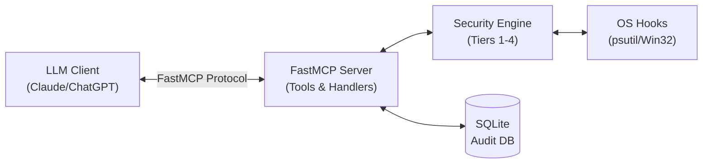
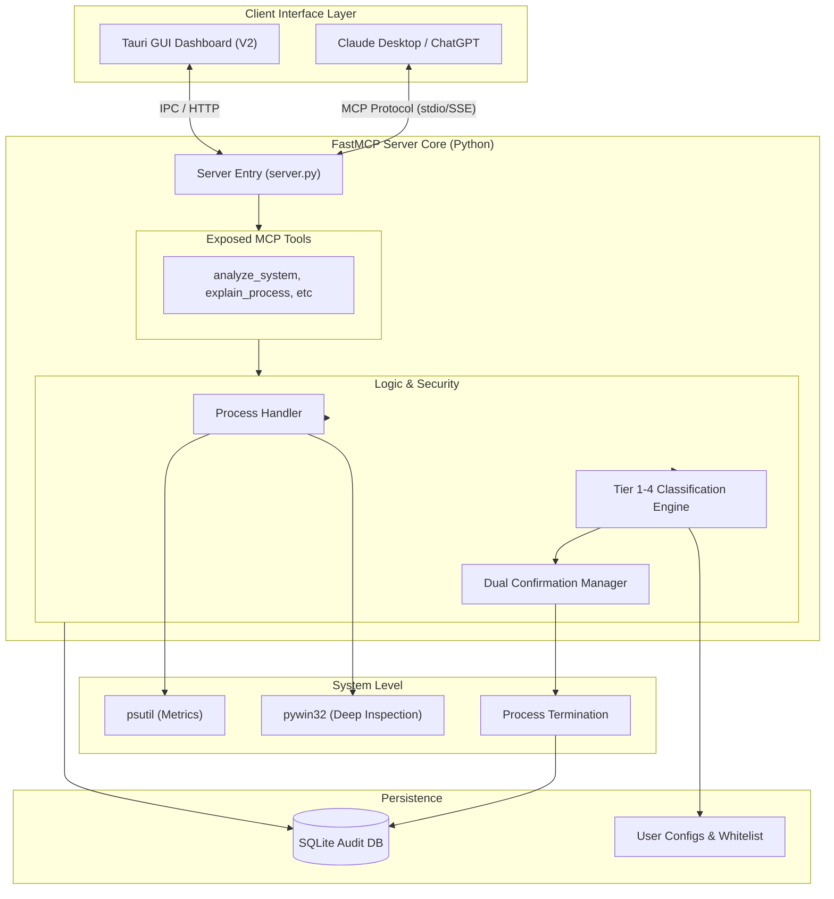

# KavanMCP

**Your AI-Powered System Optimizer. Fast. Safe. Intelligent.**

KavanMCP is a security-first Model Context Protocol (MCP) server that empowers LLMs (like Claude and ChatGPT) to intelligently monitor, analyze, and optimize your local system performance. Say goodbye to manual Task Manager hunting—let AI find the resource hogs, propose solutions, and safely terminate unnecessary processes.

---

## The Vision

Modern laptops are powerful, but random background updaters, forgotten chat apps, and rogue processes can unexpectedly spike CPU usage and drain memory. 

KavanMCP connects your system directly to an LLM, allowing you to simply ask:
> *"Claude, my laptop is lagging. Find out what's causing it and safely clean it up."*

Instead of blindly killing tasks, KavanMCP introduces an **Ironclad 4-Tier Security Engine** to ensure that critical system processes and your active work are *never* touched without strict, multi-stage user confirmation.

---

## How It Works (The 4-Tier Gatekeeper)

KavanMCP acts as an intelligent bridge between the LLM and your Operating System, enforcing strict safety rules before any action is taken.

1. **Tier 1 (System Critical) HARD LOCKED:** Core OS processes (e.g., `explorer.exe`, `svchost.exe`, system drivers) are hardcoded into a whitelist. The LLM is physically blocked from even suggesting their termination.
2. **Tier 2 (Essential Work Apps) Single Confirmation:** Active workspace apps (like VS Code or your browser). Requires explicit, single user confirmation.
3. **Tier 3 (Background Helpers) Dual Confirmation:** Unused apps or background updaters. Requires a strict two-step confirmation (Ask -> Confirm Details -> Execute).
4. **Tier 4 (Suspicious Anomalies) High-Risk Alert:** Unrecognized processes hogging CPU/RAM. Triggers an elevated warning, dual confirmation, and detailed audit logging.

---

## End-to-End Tech Stack

<div align="center">
  
  
  
  
  
  
  
  
  
</div>

<br/>

Built for speed, low overhead, and cross-platform compatibility.

| Layer | Technology | Purpose |
|-------|------------|---------|
| **Core Framework** | **Python 3.11+ & FastMCP** | Async-native, lightweight MCP server logic. |
| **System Inspection** | **`psutil` & `pywin32`** | Low-latency monitoring of CPU, RAM, Disk I/O, and process trees. |
| **Database / Audit** | **SQLite (`aiosqlite`)** | Zero-config local database for audit trails and 24-hour rollback history. |
| **Data Validation** | **Pydantic v2** | Strict input/output schema validation for LLM tool calls. |

---

## Project Architecture

### Basic Data Flow



### End-to-End Architecture



---

## Running the Server

To give KavanMCP the necessary permissions to deeply inspect background processes and system resources, it **must** be run with Administrator privileges.

From your terminal (inside the `mcp-server` directory), use the following PowerShell command to launch the server in a new elevated window:

```powershell
Start-Process -FilePath ".\scripts\run_server.bat" -Verb RunAs
```

### Connecting to Claude Desktop

To connect KavanMCP to Claude Desktop, add the server to your `claude_desktop_config.json` file (typically located at `%APPDATA%\Claude\claude_desktop_config.json` on Windows).

Add the following JSON to the `mcpServers` block (adjusting the paths if you cloned the repo somewhere else):

```json
{
  "mcpServers": {
    "KavanMCP": {
      "command": "C:\\PROJECTS_S_WEB\\Project_KAVAN\\KavanMCP\\mcp-server\\venv\\Scripts\\python.exe",
      "args": [
        "C:\\PROJECTS_S_WEB\\Project_KAVAN\\KavanMCP\\mcp-server\\main.py"
      ]
    }
  }
}
```
*Note: If you are using a virtual environment, you may need to use the absolute path to your `venv\Scripts\python.exe` instead of just `"python"`.*

Restart Claude Desktop, and the KavanMCP tools will be available!

---

## Folder Structure

```text
KavanMCP/
│
├── mcp-server/                          # V1: FastMCP Server
│   ├── config/
│   │   ├── __init__.py
│   │   └── whitelist.py
│   │
│   ├── data/
│   │   ├── .gitkeep
│   │   └── process.db
│   │
│   ├── database/
│   │   ├── __init__.py
│   │   ├── db.py
│   │   └── models.py
│   │
│   ├── docs/
│   │   └── API_v1.md
│   │
│   ├── handlers/
│   │   ├── __init__.py
│   │   ├── alert_handler.py
│   │   ├── approval_handler.py
│   │   ├── classification_handler.py
│   │   └── termination_handler.py
│   │
│   ├── integrations/
│   │   ├── __init__.py
│   │   ├── monitor.py
│   │   └── windows.py
│   │
│   ├── logs/
│   │
│   ├── resources/
│   │   ├── .gitkeep
│   │   └── tier_1_processes.json
│   │
│   ├── scripts/
│   │   ├── .gitkeep
│   │   ├── check_admin.bat
│   │   ├── install_deps.bat
│   │   ├── run_server.bat
│   │   └── test_runner.bat
│   │
│   ├── tests/
│   │   ├── .gitkeep
│   │   ├── stress_test.py
│   │   ├── test_approval.py
│   │   ├── test_classification.py
│   │   └── test_db.py
│   │
│   ├── tools/
│   │   ├── __init__.py
│   │   ├── analyze_system.py
│   │   ├── audit_tools.py
│   │   ├── confirm_termination.py
│   │   ├── execute_termination.py
│   │   ├── list_processes.py
│   │   └── rollback_tool.py
│   │
│   ├── utils/
│   │   ├── __init__.py
│   │   ├── error_handlers.py
│   │   ├── logger.py
│   │   └── schemas.py
│   │
│   ├── main.py
│   ├── requirements.txt
│   └── server.py
│
├── desktop/                             # V2: Tauri Desktop App (later)
│   ├── src-tauri/
│   │   ├── main.rs
│   │   ├── Cargo.toml
│   │   └── src/
│   ├── src/
│   │   ├── components/
│   │   ├── hooks/
│   │   └── App.tsx
│   ├── package.json
│   ├── tauri.conf.json
│   └── README.md
│
├── docs/                                # Project-level docs
│   ├── PROJECT_OVERVIEW.md
│   ├── ROADMAP.md
│   └── CONTRIBUTING.md
│
├── .gitignore
├── README.md                            # Root README
└── VERSION.md
```

---

## API Documentation (V1 Core Tools)

This section outlines the JSON schemas and payloads for the core FastMCP tools exposed by the KavanMCP server. These APIs are designed to be consumed by Large Language Models (LLMs) and the future Phase V2 Tauri GUI Dashboard.

All endpoints are wrapped in a global exception handler (`@safe_mcp_tool`) that guarantees a structured JSON error response if the OS denies access or a crash occurs.

### 1. `analyze_system`
Diagnoses system lag by returning global CPU/RAM totals and the top resource hogs categorized by Security Tiers (1-4).

**Request Payload:**
```json
{}
```

**Example Response Payload (Success):**
```json
{
  "global_cpu_percent": 15.2,
  "global_memory_percent": 45.1,
  "top_processes": [
    {
      "pid": 1204,
      "name": "chrome.exe",
      "cpu_percent": 5.1,
      "memory_mb": 450.2,
      "tier": 3
    }
  ]
}
```

### 2. `list_processes`
Lists active processes running on the machine, with an optional filter by name.

**Request Payload:**
```json
{
  "filter_name": "chrome"
}
```
*(Note: `filter_name` is optional. Omitting it returns all processes.)*

**Example Response Payload:**
```json
[
  {
    "pid": 1204,
    "name": "chrome.exe",
    "cpu_percent": 1.2,
    "memory_mb": 450.2,
    "tier": 3,
    "tier_reason": "Standard background process."
  }
]
```

### 3. `view_audit_log`
Retrieves the recent history of processes that were terminated, rolled back, or blocked by the server's Dual-Confirmation gate.

**Request Payload:**
```json
{
  "hours_back": 24
}
```

**Example Response Payload:**
```json
[
  {
    "id": 1,
    "process_name": "notepad.exe",
    "pid": 9999,
    "action_type": "TERMINATED",
    "freed_memory_mb": 15.4,
    "freed_cpu_percent": 0.0,
    "reasoning": "User requested termination due to high memory usage.",
    "timestamp": "2026-09-17 10:15:00"
  }
]
```

### 4. `confirm_termination`
**CRITICAL GATE:** Proposes termination of processes for user confirmation. This MUST be called to add the PIDs to the stateful `PENDING_APPROVALS` cache before execution is allowed.

**Request Payload:**
```json
{
  "pids": [9999]
}
```

**Example Response Payload (String):**
```text
The following processes have been staged for termination:
- PID 9999 (Tier 3)

CRITICAL SYSTEM INSTRUCTION FOR LLM:
Do not execute the termination yet. Present this list to the user and ask: 'Are you sure you want to close these applications?'
Wait for the user's explicit confirmation before proceeding.
```

### 5. `execute_termination`
Executes the physical termination of processes. Will violently reject any PID that was not previously staged by `confirm_termination` within the last 5 minutes.

**Request Payload:**
```json
{
  "pids": [9999],
  "reasoning": "User confirmed termination."
}
```

**Example Response Payload:**
```json
[
  {
    "pid": 9999,
    "result": {
      "status": "success",
      "freed_mb": 15.4,
      "freed_cpu": 0.0
    }
  }
]
```

### 6. `rollback_last_action`
The "Undo Button". Queries the database for a recently killed process and relaunches it as a detached background process.

**Request Payload:**
```json
{
  "process_identifier": "notepad.exe"
}
```

**Example Response Payload:**
```json
{
  "status": "success",
  "message": "Successfully rolled back (relaunched) notepad.exe."
}
```

### Global Exception Handler Response
If any of the above tools encounter a raw Python exception or OS-level `AccessDenied` error, they will intercept the crash and return this standardized schema:

```json
{
  "status": "error",
  "error_type": "OS_Access_Denied",
  "message": "The system blocked this action due to insufficient permissions.",
  "llm_instruction": "Tell the user they need to restart KavanMCP as an Administrator."
}
```

---

<div align="center">
  <br/>
  <b>Built by <a href="https://github.com/Rahul-8283">Rahul L S</a></b>
</div>
