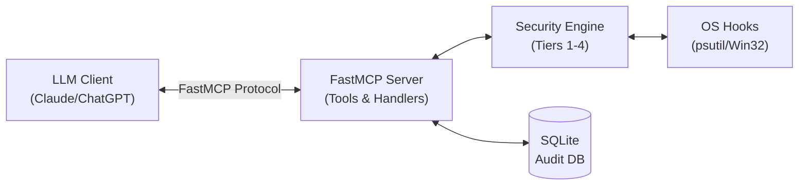
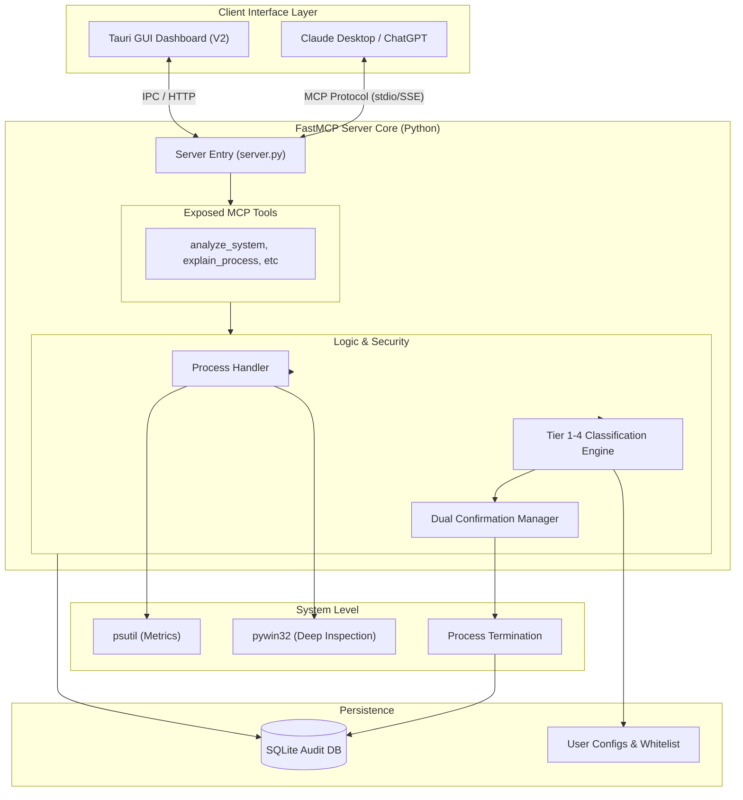

# KavanMCP

**Your AI-Powered System Optimizer. Fast. Safe. Intelligent.**

KavanMCP is a security-first Model Context Protocol (MCP) server that empowers LLMs (like Claude and ChatGPT) to intelligently monitor, analyze, and optimize your local system performance. Say goodbye to manual Task Manager hunting—let AI find the resource hogs, propose solutions, and safely terminate unnecessary processes.

---

## The Vision

Modern laptops are powerful, but random background updaters, forgotten chat apps, and rogue processes can unexpectedly spike CPU usage and drain memory. 

KavanMCP connects your system directly to an LLM, allowing you to simply ask:
> *"Claude, my laptop is lagging. Find out what's causing it and safely clean it up."*

Instead of blindly killing tasks, KavanMCP introduces an **Ironclad 4-Tier Security Engine** to ensure that critical system processes and your active work are *never* touched without strict, multi-stage user confirmation.

---

## How It Works (The 4-Tier Gatekeeper)

KavanMCP acts as an intelligent bridge between the LLM and your Operating System, enforcing strict safety rules before any action is taken.

1. **Tier 1 (System Critical) HARD LOCKED:** Core OS processes (e.g., `explorer.exe`, `svchost.exe`, system drivers) are hardcoded into a whitelist. The LLM is physically blocked from even suggesting their termination.
2. **Tier 2 (Essential Work Apps) Single Confirmation:** Active workspace apps (like VS Code or your browser). Requires explicit, single user confirmation.
3. **Tier 3 (Background Helpers) Dual Confirmation:** Unused apps or background updaters. Requires a strict two-step confirmation (Ask -> Confirm Details -> Execute).
4. **Tier 4 (Suspicious Anomalies) High-Risk Alert:** Unrecognized processes hogging CPU/RAM. Triggers an elevated warning, dual confirmation, and detailed audit logging.

---

## End-to-End Tech Stack

<div align="center">
  
  
  
  
  
  
  
  
  
</div>

<br/>

Built for speed, low overhead, and cross-platform compatibility.

| Layer | Technology | Purpose |
|-------|------------|---------|
| **Core Framework** | **Python 3.11+ & FastMCP** | Async-native, lightweight MCP server logic. |
| **System Inspection** | **`psutil` & `pywin32`** | Low-latency monitoring of CPU, RAM, Disk I/O, and process trees. |
| **Database / Audit** | **SQLite (`aiosqlite`)** | Zero-config local database for audit trails and 24-hour rollback history. |
| **Data Validation** | **Pydantic v2** | Strict input/output schema validation for LLM tool calls. |

---

## Project Architecture

### Basic Data Flow



### End-to-End Architecture



---

## Running the Server

To give KavanMCP the necessary permissions to deeply inspect background processes and system resources, it **must** be run with Administrator privileges.

From your terminal (inside the `mcp-server` directory), use the following PowerShell command to launch the server in a new elevated window:

```powershell
Start-Process -FilePath ".\scripts\run_server.bat" -Verb RunAs
```

---

## Folder Structure

```text
KavanMCP/
│
├── mcp-server/                          # V1: FastMCP Server
│   ├── config/
│   │   ├── __init__.py
│   │   ├── settings.py                  # Load config.json, env vars
│   │   └── whitelist.py                 # Tier 1 critical processes
│   │
│   ├── tools/                           # MCP Tool Definitions
│   │   ├── __init__.py
│   │   ├── analyze_system.py
│   │   ├── list_processes.py
│   │   ├── explain_process.py
│   │   ├── confirm_termination.py
│   │   └── execute_termination.py
│   │
│   ├── handlers/                        # Tool Implementation Logic
│   │   ├── __init__.py
│   │   ├── process_handler.py
│   │   ├── classification_handler.py
│   │   ├── termination_handler.py
│   │   └── alert_handler.py
│   │
│   ├── utils/
│   │   ├── __init__.py
│   │   ├── formatters.py
│   │   ├── logger.py
│   │   └── validators.py
│   │
│   ├── resources/                       # Static Data
│   │   ├── __init__.py
│   │   ├── tier_1_processes.json
│   │   └── alert_templates.json
│   │
│   ├── database/
│   │   ├── __init__.py
│   │   ├── db.py                        # SQLite CRUD
│   │   └── models.py                    # Schema
│   │
│   ├── integrations/
│   │   ├── __init__.py
│   │   ├── windows.py                   # pywin32 wrappers
│   │   └── monitor.py                   # psutil wrappers
│   │
│   ├── data/                            # Runtime (git-ignored)
│   │   ├── process.db
│   │   ├── config.json
│   │   └── whitelist.json
│   │
│   ├── logs/                            # Logs (git-ignored)
│   │   └── audit_trail.log
│   │
│   ├── tests/
│   │   ├── __init__.py
│   │   ├── conftest.py
│   │   ├── test_tools.py
│   │   ├── test_handlers.py
│   │   └── fixtures.py
│   │
│   ├── docs/
│   │   ├── SETUP.md
│   │   ├── ARCHITECTURE.md
│   │   └── API.md
│   │
│   ├── scripts/
│   │   ├── install_deps.bat
│   │   ├── run_server.bat
│   │   └── check_admin.bat
│   │
│   ├── __init__.py
│   ├── main.py                          # CLI entry point
│   ├── server.py                        # FastMCP server setup
│   ├── requirements.txt
│   ├── setup.py
│   ├── .env
│   ├── .gitignore
│   └── README.md
│
├── desktop/                             # V2: Tauri Desktop App (later)
│   ├── src-tauri/
│   │   ├── main.rs
│   │   ├── Cargo.toml
│   │   └── src/
│   ├── src/
│   │   ├── components/
│   │   ├── hooks/
│   │   └── App.tsx
│   ├── package.json
│   ├── tauri.conf.json
│   └── README.md
│
├── docs/                                # Project-level docs
│   ├── PROJECT_OVERVIEW.md
│   ├── ROADMAP.md
│   └── CONTRIBUTING.md
│
├── .gitignore
├── README.md                            # Root README
└── VERSION.md
```
