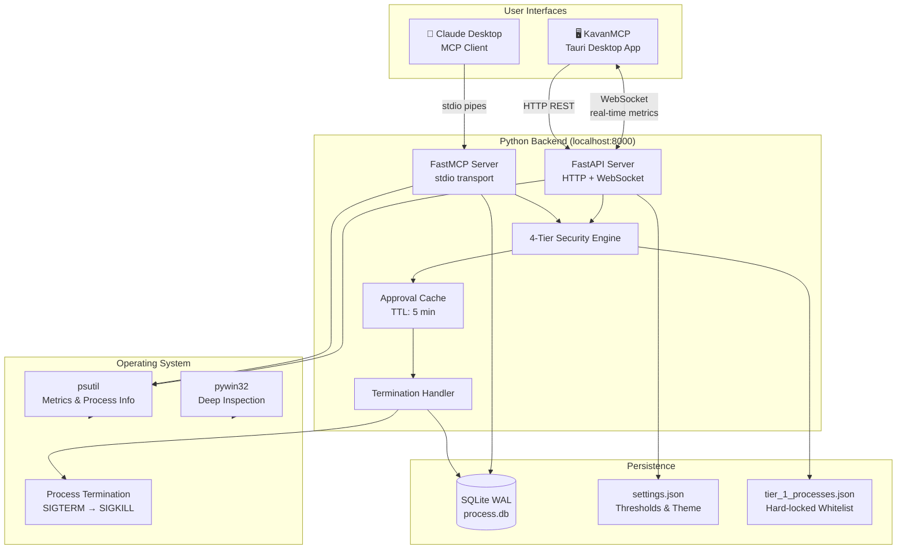
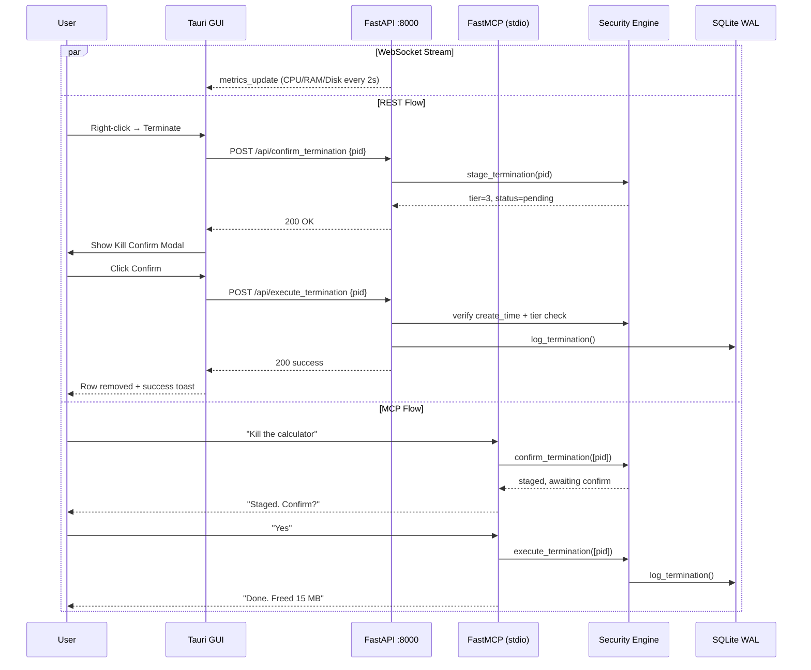
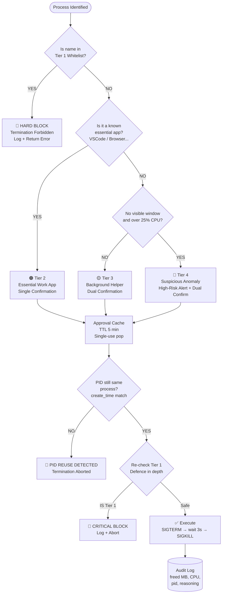
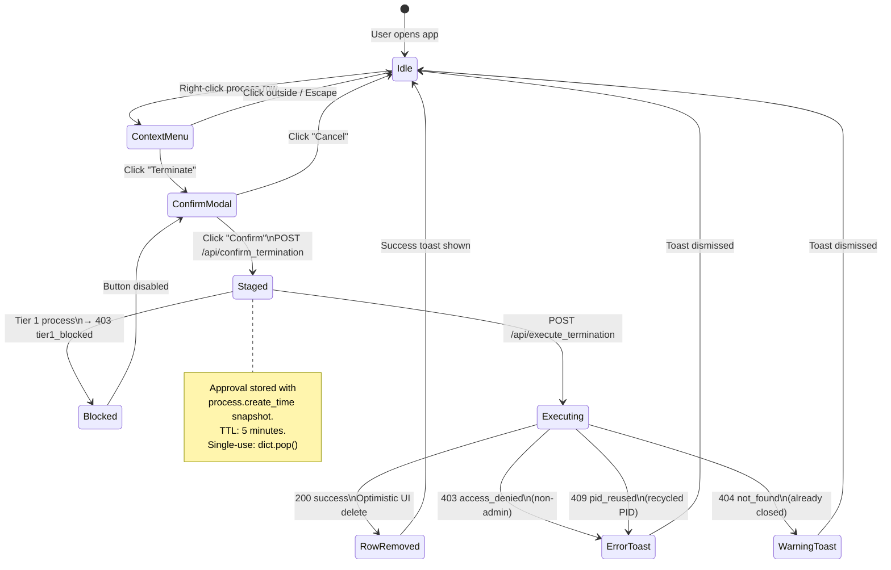
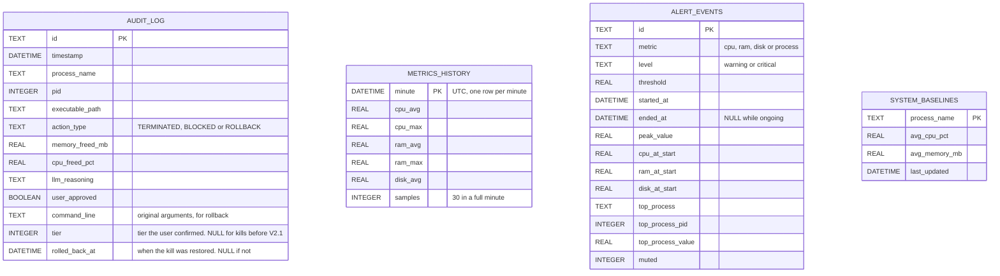
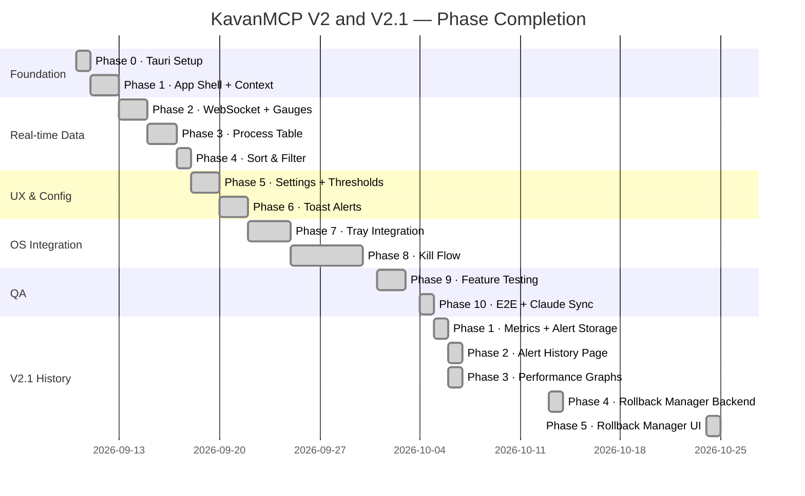
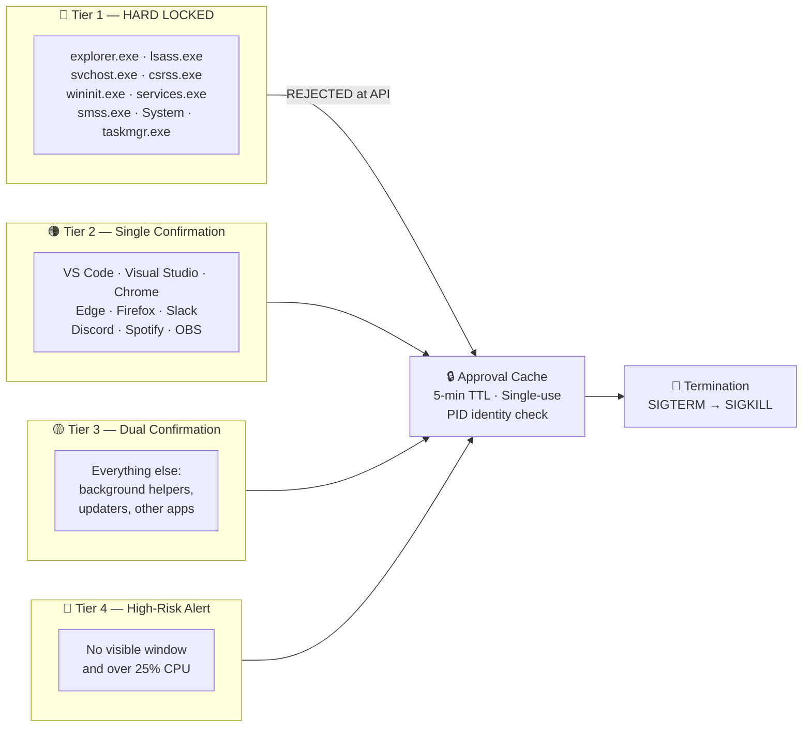

<div align="center">
  
  <h1>KavanMCP</h1>
  <p><strong>AI-Powered System Optimizer · Dual-Interface · Ironclad Safety</strong></p>
  <p>
    <a href="https://github.com/Rahul-8283/KavanMCP/blob/main/LICENSE"></a>
    <a href="https://github.com/Rahul-8283/KavanMCP/commit/598af3a"></a>
    
    
    
  </p>
</div>

---

## What is KavanMCP?

KavanMCP is a **dual-interface AI-powered system optimizer** for Windows. It lets you monitor, analyze, and safely terminate resource-hogging processes — either through a real-time desktop dashboard or by asking Claude AI in plain English.

Instead of manually hunting down processes in Task Manager, you can simply say:

> *"Claude, my laptop is lagging. Find what's causing it and safely clean it up."*

KavanMCP bridges your OS directly to an AI agent through the [Model Context Protocol (MCP)](https://modelcontextprotocol.io/), while simultaneously running a Tauri desktop GUI that gives you visual control over the same data. Both interfaces share a single SQLite audit database — concurrent writes are safe by design (WAL mode).

The **Ironclad 4-Tier Security Engine** ensures that no critical system process can ever be killed, even if Claude recommends it.

---

## Tech Stack

<div align="center">

### Backend
[](https://python.org)
[](https://fastapi.tiangolo.com)
[](https://gofastmcp.com)
[](https://sqlite.org)
[](https://docs.pydantic.dev)
[](https://github.com/giampaolo/psutil)
[](https://github.com/mhammond/pywin32)
[](https://github.com/omnilib/aiosqlite)
[](https://www.uvicorn.org)

### Desktop GUI
[](https://tauri.app)
[](https://rust-lang.org)
[](https://react.dev)
[](https://typescriptlang.org)
[](https://vite.dev)
[](https://tailwindcss.com)
[](https://recharts.org)
[](https://axios-http.com)
[](https://lucide.dev)
[](https://tanstack.com/virtual)

### Testing & Tooling
[](https://pytest.org)
[](https://docs.astral.sh/ruff)

</div>

---

## Architecture

### High-Level System Overview



### Dual-Interface Data Flow



### The 4-Tier Security Decision Engine



### Kill Flow State Machine



### SQLite Database Schema



`metrics_history` is kept for 7 days and closed alerts for 30. `system_baselines` is created but not yet written to.

### Phase Progression (V2 and V2.1 Roadmap)



---

## Key Features

| Feature | Detail |
|---|---|
| 🔴 **Tier 1 Hard Lock** | `explorer.exe`, `lsass.exe`, `svchost.exe` and others are physically un-killable — the UI disables the Confirm button and the backend rejects the request at three independent gates |
| 🛡️ **PID Reuse Protection** | Approval stores the process `create_time` at staging time; if a different process recycles the same PID before execution, the kill is aborted |
| 🎯 **Single-Use Approvals** | `dict.pop()` semantics mean a confirmed PID can only be executed once — double-clicks and replay attacks are blocked |
| ⚡ **Non-Blocking Backend** | Long-running psutil scans run in worker threads via `asyncio.to_thread` so the event loop never freezes under a heavy process list |
| 📊 **Real-Time Dashboard** | WebSocket pushes CPU/RAM/Disk metrics every 2 seconds with threshold-triggered alerts and colour-coded gauges |
| 📋 **Virtualized Process Table** | `@tanstack/react-virtual` renders 800+ processes at 60fps — only visible rows are in the DOM |
| ⚙️ **Persistent Settings** | Thresholds and the sound toggle persist to `settings.json`, and the UI rolls back on failed saves; the theme is remembered by the app itself |
| 🔔 **Native Notifications** | Tauri Notification API fires Windows Action Center alerts on CPU/RAM spikes even when the window is hidden |
| 🗂️ **System Tray** | Left-click restores the window; right-click opens the menu; icon colour reflects the current alert state |
| ↩️ **Undo (Rollback)** | A killed process is relaunched from the audit log's stored executable path, with its original arguments. `GET /api/kills` lists recent kills with their tier and whether each can still be restored, and `POST /api/rollback` restores one exact kill by its id. A kill is restored once, whether from the API or from the `rollback_last_action` tool. In the app, the **Recently Killed** page lists the last 24 hours or 7 days with a one-click Restore on each row, and the toast after a kill offers **Undo** |
| 🗃️ **Continuous History** | The backend records one row of CPU/RAM/disk per minute and one row per alert episode, whether or not the window is open. Metrics are kept 7 days, alerts 30 |
| 📜 **Alert History** | Every alert with when it started and ended, its peak, the readings at that moment and the top process at the time. Filter by date, type and severity; updates live without polling |
| 📈 **Performance Trends** | CPU, memory and disk over 1 hour to 7 days, with the peak band, threshold line and alert regions. Drag the overview to pan and zoom; zooming loads finer detail. A period with no data is drawn as a gap |
| 🕵️ **Suspicious-Process Watch** | A scan once a minute raises an alert for any process with no window using over 25% CPU, without the dashboard being open |
| 🤝 **Dual-Interface Concurrency** | SQLite WAL mode allows the Tauri HTTP backend and Claude's stdio process to read/write simultaneously without lock errors |

---

## Project Structure

```text
KavanMCP/
├── mcp-server/                      # Python backend
│   ├── main.py                      # Entry point: boots MCP server + FastAPI + TTL sweeper
│   ├── server.py                    # 7 MCP tool definitions (FastMCP)
│   ├── ws_server.py                 # FastAPI app: REST + WebSocket, history recording loops
│   ├── routes/
│   │   ├── history.py               # /api/alerts and /api/metrics/history
│   │   └── kills.py                 # /api/kills and /api/rollback
│   ├── handlers/
│   │   ├── approval_handler.py      # PENDING_APPROVALS TTL cache
│   │   ├── classification_handler.py# 4-Tier classification logic
│   │   ├── termination_handler.py   # psutil kill + WAL audit log + rollback
│   │   ├── alert_handler.py         # Per-process anomaly flags
│   │   ├── history_recorder.py      # Minute aggregation + alert episode tracking
│   │   └── process_watch.py         # Timed scan: Tier 4 alerts, top-process lookup
│   ├── tools/
│   │   ├── analyze_system.py        # Resource analysis MCP tool
│   │   ├── list_processes.py        # Process enumeration MCP tool
│   │   ├── explain_process.py       # Deep inspection of one process
│   │   ├── confirm_termination.py   # Stage PIDs (MCP interface)
│   │   ├── execute_termination.py   # Execute staged kills (MCP interface)
│   │   ├── audit_tools.py           # Audit log viewer
│   │   └── rollback_tool.py         # Process resurrection
│   ├── config/
│   │   ├── whitelist.py             # Tier 1 whitelist loader
│   │   └── settings_manager.py      # Threshold config (settings.json)
│   ├── database/
│   │   ├── db.py                    # aiosqlite helpers + WAL init
│   │   └── models.py                # SQL schema definitions
│   ├── integrations/
│   │   ├── monitor.py               # psutil metrics polling
│   │   └── windows.py               # pywin32 window detection + deep inspection
│   ├── utils/
│   │   ├── logger.py                # File + stderr logging
│   │   ├── schemas.py               # Pydantic models
│   │   ├── error_handlers.py        # MCP tool error wrapper
│   │   ├── privileges.py            # is_admin()
│   │   └── timefmt.py               # UTC timestamp conversions
│   ├── tests/
│   │   ├── test_approval.py         # Approval cache
│   │   ├── test_classification.py   # Tier classification
│   │   ├── test_db.py               # Database helpers
│   │   ├── test_monitor.py          # Process scan
│   │   ├── test_explain_process.py  # explain_process tool
│   │   ├── test_rollback.py         # Rollback with original arguments, by id, and once
│   │   ├── test_kills_api.py        # /api/kills and /api/rollback
│   │   ├── kill_helpers.py          # Puts kill rows into the test database
│   │   ├── test_termination_api.py  # Kill flow and API boundary
│   │   ├── test_phase9_backend.py   # WebSocket + settings persistence
│   │   ├── test_phase10_backend.py  # WAL concurrency
│   │   ├── test_history_recorder.py # Aggregation, episodes, watch, retention
│   │   ├── test_alerts_api.py       # /api/alerts and alert_event messages
│   │   └── test_metrics_api.py      # /api/metrics/history
│   ├── resources/
│   │   └── tier_1_processes.json    # Hardcoded Tier 1 whitelist
│   └── requirements.txt
│
├── desktop/                         # Tauri + React frontend
│   ├── src-tauri/
│   │   ├── src/lib.rs               # Tauri commands (quit_app, etc.)
│   │   ├── capabilities/default.json# ACL permissions
│   │   └── tauri.conf.json          # Window, tray, icon config
│   └── src/
│       ├── App.tsx                  # Root: hook initialization, page lookup
│       ├── pages/
│       │   ├── Dashboard.tsx        # Gauges + process table
│       │   ├── Alerts.tsx           # Alert history
│       │   ├── Trends.tsx           # Performance graphs (loaded on demand)
│       │   ├── RecentlyKilled.tsx   # Kills of the last 24 hours or 7 days, with Restore
│       │   └── Settings.tsx         # Threshold sliders + toggles
│       ├── components/
│       │   ├── dashboard/
│       │   │   ├── GaugeCard.tsx            # SVG ring dial with a threshold zone
│       │   │   ├── ProcessTable.tsx          # Virtualized table + kill wiring
│       │   │   ├── ProcessContextMenu.tsx    # Right-click menu (portal)
│       │   │   ├── KillConfirmModal.tsx      # Tier-aware confirm dialog
│       │   │   └── TierBadge.tsx             # Tier 1-4 visual chips
│       │   ├── alerts/
│       │   │   ├── AlertTable.tsx           # Virtualized alert list
│       │   │   ├── AlertFilters.tsx         # Date, type and severity filters
│       │   │   ├── AlertDetail.tsx          # Expanded row + "Show on graph"
│       │   │   └── LevelBadge.tsx           # Warning / Critical chip
│       │   ├── trends/
│       │   │   ├── MetricChart.tsx          # One chart: line, peak band, limit, alerts
│       │   │   ├── OverviewStrip.tsx        # Brush for pan and zoom
│       │   │   └── ChartTooltip.tsx         # Bucket values + overlapping alerts
│       │   ├── rollback/
│       │   │   ├── KillTable.tsx            # Kill list with an expandable row
│       │   │   ├── RestoreCell.tsx          # Restore button, spinner, restored time or reason
│       │   │   ├── rows.ts                  # Pure row updates after a restore
│       │   │   └── wording.ts               # Restore failure codes to sentences
│       │   ├── common/
│       │   │   ├── Toast.tsx                # Single alert component
│       │   │   ├── ToastContainer.tsx        # Toast queue renderer
│       │   │   ├── EmptyState.tsx           # Loading / empty / failed state
│       │   │   ├── SegmentedControl.tsx     # Radio-group filter
│       │   │   ├── Switch.tsx               # Toggle
│       │   │   └── ErrorBoundary.tsx        # Crash fallback
│       │   └── layout/
│       │       ├── Header.tsx               # Top bar + status dot
│       │       ├── Sidebar.tsx              # Navigation rail
│       │       ├── MainLayout.tsx           # Page scaffold
│       │       └── views.ts                 # Page names and titles
│       ├── context/
│       │   ├── ConfigContext.tsx         # Settings with ref-based closure safety
│       │   ├── MetricsContext.tsx        # CPU/RAM/Disk live state
│       │   ├── ProcessContext.tsx        # Process list state
│       │   ├── AlertHistoryContext.tsx   # Alert list, filters, live updates
│       │   ├── NavigationContext.tsx     # Active page + cross-page target
│       │   └── ToastContext.tsx          # Toast queue state
│       ├── hooks/
│       │   ├── useWebSocketConnection.ts  # Reconnect with exponential backoff
│       │   ├── useProcessManager.ts       # Kill cascade logic, and Undo after a kill
│       │   ├── useKillHistory.ts          # Recent kills and restoring them one at a time
│       │   ├── useTrayIntegration.ts      # Global tray with offline awareness
│       │   └── useWindowLifecycle.ts      # Hide-on-close behaviour
│       ├── services/
│       │   └── api.ts               # Axios client + typed endpoints
│       ├── utils/
│       │   ├── time.ts              # Duration and date formatting
│       │   └── series.ts            # Gap filling and window statistics
│       └── styles/
│           └── index.css            # Design tokens for both themes
│
├── phases/                          # V1 build plans
├── phases_v2/                       # V2 build plans (Phase0_v2.md … Phase10_v2.md)
├── phase_v2_1/                      # V2.1 plan and its 8 phase files
│
├── docs/                            # PRD, TRD and API documents
├── CLAUDE.md                        # Claude Code development guide
├── kavan_logo.jpg
└── README.md
```

---

## Getting Started

### Prerequisites

| Requirement | Notes |
|---|---|
| Windows 10/11 | pywin32 and Tauri tray require Windows |
| Python 3.11+ | `python --version` to verify |
| Node.js 20+ | For the Tauri frontend |
| Rust (stable) | `rustup install stable` |
| Administrator rights | psutil deep inspection requires elevation |

### 1 · Clone & install backend dependencies

```powershell
git clone https://github.com/Rahul-8283/KavanMCP.git
cd KavanMCP/mcp-server

python -m venv venv
.\venv\Scripts\Activate.ps1
pip install -r requirements.txt
```

### 2 · Run the backend (elevated)

The server **must** run as Administrator to inspect privileged processes.

```powershell
# Open an elevated PowerShell, then:
python main.py
```

Or use the provided script:

```powershell
Start-Process -FilePath ".\scripts\run_server.bat" -Verb RunAs
```

The FastAPI server starts on `http://127.0.0.1:8000` and the FastMCP server listens on stdio.

### 3 · Run the desktop app (dev mode)

```powershell
cd ../desktop
npm install
npm run tauri dev
```

### 4 · Connect to Claude Desktop

Add to `%APPDATA%\Claude\claude_desktop_config.json`:

```json
{
  "mcpServers": {
    "KavanMCP": {
      "command": "C:\\path\\to\\KavanMCP\\mcp-server\\venv\\Scripts\\python.exe",
      "args": [
        "C:\\path\\to\\KavanMCP\\mcp-server\\main.py"
      ]
    }
  }
}
```

Restart Claude Desktop. KavanMCP tools will appear automatically.

### 5 · Run the test suite

```powershell
cd mcp-server
python -m pytest -q
# 195 passed
```

---

## MCP Tool Reference

### `analyze_system`
Returns global CPU/RAM totals and the top resource hogs classified by tier.

```jsonc
// Request
{}

// Response
{
  "total_cpu_percent": 15.2,
  "total_memory_gb": 15.8,
  "used_memory_gb": 7.1,
  "top_cpu_hogs": [
    { "pid": 1204, "name": "chrome.exe", "cpu_percent": 5.1, "memory_mb": 450.2,
      "tier": 2, "is_headless": false, "anomaly_flags": [] }
  ],
  "top_memory_hogs": [ /* same shape */ ]
}
```

### `list_processes`
Lists running processes with an optional name filter. Tier 1 processes are left out unless `include_tier_1` is true or a name is searched for.

```jsonc
// Request (both are optional)
{ "filter_name": "chrome", "include_tier_1": false }
```

### `explain_process`
Deep inspection of one process before proposing to terminate it: command line, executable path, parent and children, third-party modules and safety notes.

```jsonc
{ "pid": 1204 }
```

### `confirm_termination`
**Stage gate.** Adds PIDs to the approval cache. The LLM must present this list to the user before calling `execute_termination`.

```jsonc
{ "pids": [9999, 8888] }
```

### `execute_termination`
**Kill gate.** Only executes PIDs previously staged by `confirm_termination` within 5 minutes.

```jsonc
{ "pids": [9999], "reasoning": "User confirmed; freeing memory." }
```

### `view_audit_log`
Returns the recent termination history from the SQLite WAL database.

```jsonc
{ "hours_back": 24 }
```

### `rollback_last_action`
Relaunches the most recent kill of that name or PID that has not been restored yet, from its stored executable path and with its original arguments. A kill already restored through the REST API is skipped.

```jsonc
{ "process_identifier": "notepad.exe" }
```

---

## REST API Quick Reference

All endpoints are on `http://127.0.0.1:8000`. CORS is restricted to Tauri window origins, and a request from any other web origin is refused before it reaches a route.

| Method | Path | Description |
|---|---|---|
| `GET` | `/api/list_processes` | All running processes with tier classification |
| `GET` | `/api/get_config` | Current thresholds and UI preferences |
| `POST` | `/api/update_thresholds` | Partially update config (cpu/ram/disk/theme/sound) |
| `POST` | `/api/confirm_termination` | Stage a PID (rejects Tier 1 immediately) |
| `POST` | `/api/execute_termination` | Execute a staged kill (verifies create\_time). The response carries `audit_id`, the id of the kill's audit row |
| `GET` | `/api/alerts` | Alert history. Filters: `from`, `to`, `metric`, `level`, `limit` |
| `GET` | `/api/metrics/history` | CPU/RAM/disk over time. `range` (`1h`, `6h`, `24h`, `7d`) or `from` + `to` |
| `GET` | `/api/kills` | Processes killed in the last `hours` (1 to 168, default 24), newest first, each with `tier`, `can_restore` and `restore_blocked_reason`. Also `backend_elevated` |
| `POST` | `/api/rollback` | Restore one kill: `{ "id": "<audit_id>" }`. Starts the recorded program with its recorded arguments, at most once |
| `WS` | `/ws` | `metrics_update` every 2s, `threshold_alert` when a limit is exceeded, `alert_event` when a stored alert starts, changes or ends |

### Error codes returned in `detail.code`

| Code | HTTP | Meaning |
|---|---|---|
| `tier1_blocked` | 403 | Tier 1 system process — always rejected |
| `self_protected` | 403 | The PID is KavanMCP itself or the process that launched it |
| `forbidden_origin` | 403 | The request came from a web origin other than the app |
| `access_denied` | 403 | Needs Administrator rights |
| `not_approved` | 409 | PID not staged or approval expired |
| `pid_reused` | 409 | A different process now holds this PID |
| `not_found` | 404 | Process already exited, or no kill has that id |
| `already_restored` | 409 | That kill was restored already |
| `no_path`, `exe_missing` | 422 | The kill has no recorded executable, or it is no longer on disk |
| `launch_failed` | 500 | Windows refused to start the program. The kill stays restorable, so it can be retried |
| `invalid_range`, `range_too_short`, `range_too_long` | 400 | A history window that is reversed, under 10 minutes or over 7 days |
| `error` | 500 | Unexpected failure |

---

## Security Model



Tier 1 is enforced at **four independent layers**:
1. `stage_termination` — rejects at the staging step, logs the attempt and never adds to the approval cache
2. `execute_approved_termination` — re-checks tier at the kill gate (defence in depth)
3. `_terminate_blocking` — checks once more directly in front of the OS call, so no caller can skip it
4. `KillConfirmModal` — disables the Confirm button in the UI so the request is never sent

---

<div align="center">
  <br/>
  <p>Built by <a href="https://github.com/Rahul-8283"><strong>Rahul L S</strong></a></p>
  <p><sub>KavanMCP V2 · Production Grade</sub></p>
</div>
