<div align="center">
  
  <h1>KavanMCP</h1>
  <p><strong>AI-Powered System Optimizer · Dual-Interface · Ironclad Safety</strong></p>
  <p>Find what is slowing your Windows PC, understand why, and end it safely, from a desktop app or by asking Claude.</p>
  <p>
    <a href="https://github.com/Rahul-8283/KavanMCP/blob/main/LICENSE"></a>
    
    
    
    
    <a href="https://kavanmcp.vercel.app"></a>
  </p>
  <p>
    <a href="https://kavanmcp.vercel.app"><strong>Website</strong></a> ·
    <a href="#getting-started"><strong>Getting started</strong></a> ·
    <a href="#architecture"><strong>Architecture</strong></a> ·
    <a href="#security-model"><strong>Security</strong></a> ·
    <a href="docs/RELEASE_NOTES_V2_1_5.md"><strong>Release notes</strong></a>
  </p>
</div>

<p align="center">
  <picture>
    <source media="(prefers-color-scheme: dark)" srcset="web/shots-src/dashboard-dark.png" />
    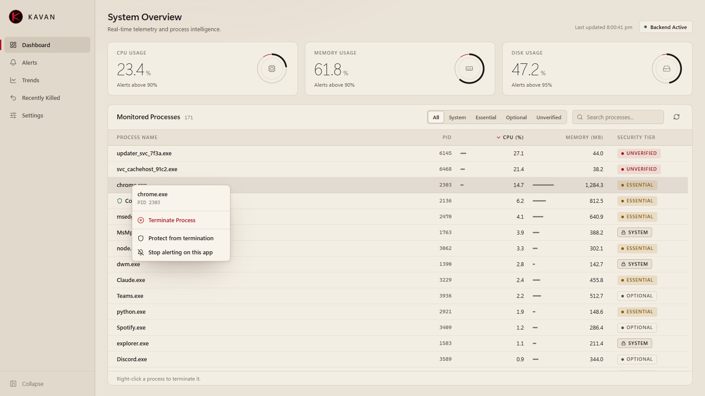
  </picture>
</p>

---

## Table of contents

1. [Overview](#overview)
2. [Why Kavan exists](#why-kavan-exists)
3. [How it works at a glance](#how-it-works-at-a-glance)
4. [See it in action](#see-it-in-action)
5. [Key features](#key-features)
6. [Architecture](#architecture)
7. [Security model](#security-model)
8. [Tech stack](#tech-stack)
9. [Design decisions](#design-decisions)
10. [Project structure](#project-structure)
11. [Getting started](#getting-started)
12. [Configuration](#configuration)
13. [MCP tool reference](#mcp-tool-reference)
14. [REST and WebSocket API reference](#rest-and-websocket-api-reference)
15. [Data and privacy](#data-and-privacy)
16. [Testing](#testing)
17. [The website](#the-website)
18. [Releasing](#releasing)
19. [Roadmap](#roadmap)
20. [Troubleshooting](#troubleshooting)
21. [Documentation index](#documentation-index)
22. [Contributing](#contributing)
23. [License](#license)

---

## Overview

**KavanMCP** (Kavan for short) is a **dual-interface system optimizer for Windows**. It watches your CPU, memory and disk, records what was using them whenever something spikes, and lets you end the right program safely, either by clicking in a real-time desktop dashboard or by asking Claude in plain English.

> *"Claude, my laptop is lagging. Find what's causing it and safely clean it up."*

Two interfaces share one backend and one database:

| Interface | What it is | Best for |
|---|---|---|
| **Kavan desktop app** | A Tauri window and system tray with live gauges, a process table, alert history, trend charts and one-click Undo | Glanceable awareness and instant manual action |
| **Claude Desktop (MCP)** | Seven tools that let Claude look at your system, propose what to close, and act only after you confirm | Asking abstract questions such as "what is slowing my PC?" |

Both are guarded by the same **Ironclad 4-Tier Security Engine**, so no critical Windows process can ever be ended, whether the request comes from you, a script, or an AI.

| At a glance | |
|---|---|
| Version | **2.1.5** |
| Platform | Windows 10 and 11, 64-bit |
| Interfaces | Tauri desktop app, Claude Desktop over the Model Context Protocol |
| MCP tools | 7 |
| API | 9 REST endpoints and 1 WebSocket |
| Database | SQLite in WAL mode, 4 tables |
| Tests | 641 backend and 81 desktop |
| Installer size | About 2.3 MB |
| Privacy | Local only: no cloud, no account, no API key, no telemetry in the app |

---

## Why Kavan exists

The Windows Task Manager shows you hundreds of processes and no answer. When the machine slows down, you have to notice it, open a tool, sort a list, recognise a program name, guess whether it is safe to end, and hope you do not close something that matters. And the moment the spike passes, the evidence is gone.

An AI assistant can reason about that data, but a chat window alone cannot show a live gauge, and giving an AI the power to end processes is only acceptable if it can never end the wrong one.

Kavan was built around those gaps:

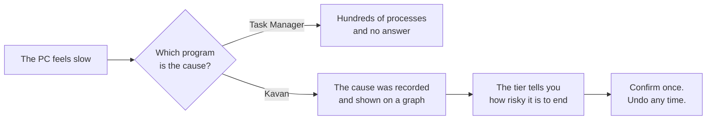

| Problem | How Kavan answers it |
|---|---|
| You only find out about a spike if you happen to be looking | Passive monitoring that records history even with the window closed, and native alerts |
| A spike passes and the cause is gone | Every alert stores its peak, the readings at that moment, and the program that was using the most |
| It is hard to tell what is safe to end | Every process is sorted into one of four security tiers |
| Giving an AI control of your PC is risky | A two-step confirm for every kill, and hard locks that no request can bypass |
| Ending the wrong program costs time | One-click restore, from the toast or the Recently Killed page |
| Privacy tools should not phone home | Everything stays on your machine |

### Design principles

| Principle | What it means in practice |
|---|---|
| **Push over poll** | The backend pushes metrics over a WebSocket every 2 seconds. The desktop app never polls for them |
| **Zero-lock concurrency** | The desktop app and Claude's process read and write the same SQLite file at once without corruption (WAL mode) |
| **Local-first** | No external API, no cloud database, no account |
| **Ironclad safety** | The UI enforces exactly the same Tier 1 protection as the backend and as Claude |
| **Human in the loop** | Kavan never ends anything on its own. Every kill is confirmed by a person |
| **Client-side heavy** | Sorting and filtering large process lists happen in the UI, so the backend stays focused on system calls |

---

## How it works at a glance

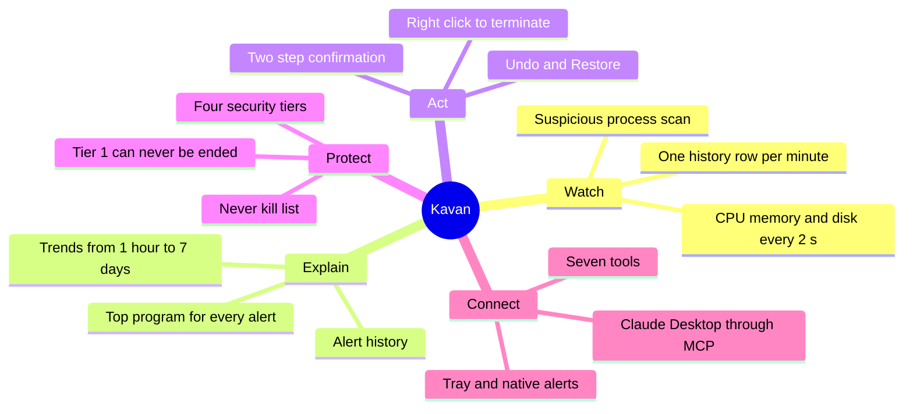

A typical session:

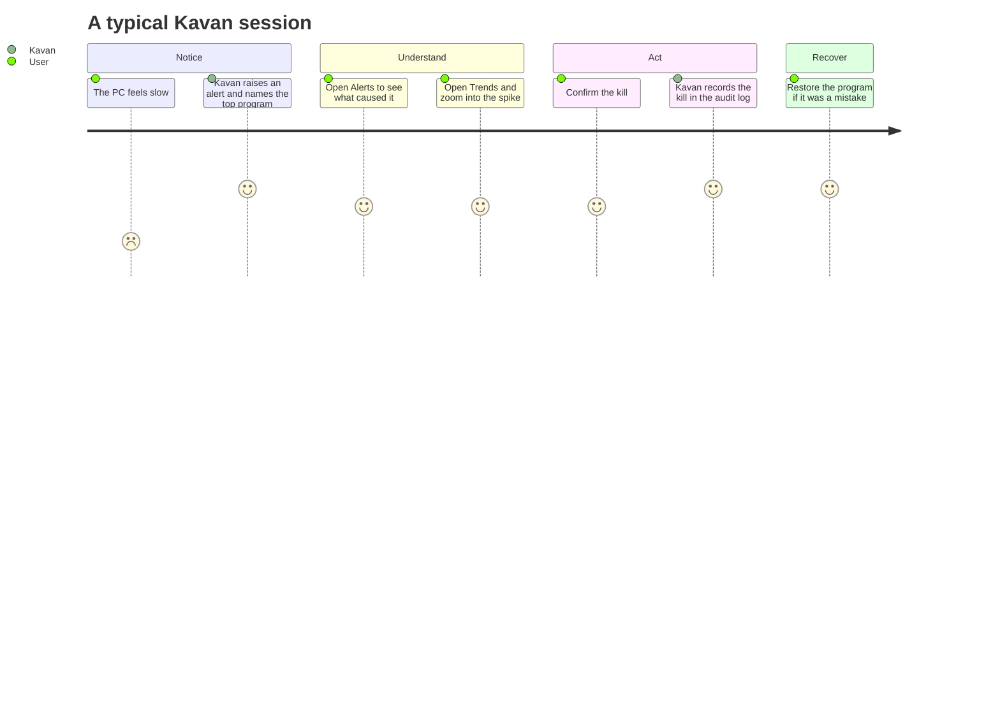

---

## See it in action

Captured from the real 2.1.5 app, with synthetic data. The images follow your GitHub theme.

### Alert history

What started it, how high it went, and what was using the most. Open a row to see the readings at that moment, and use **Show on graph** to jump to the chart.

<p align="center">
  <picture>
    <source media="(prefers-color-scheme: dark)" srcset="web/shots-src/alerts-dark.png" />
    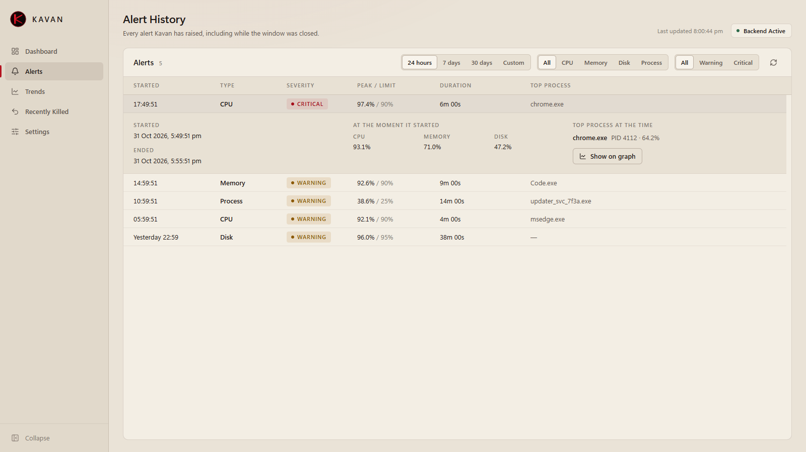
  </picture>
</p>

### Performance trends

Charts from 1 hour to 7 days. Drag the strip at the bottom to zoom into a spike.

<p align="center">
  <picture>
    <source media="(prefers-color-scheme: dark)" srcset="web/shots-src/trends-dark.png" />
    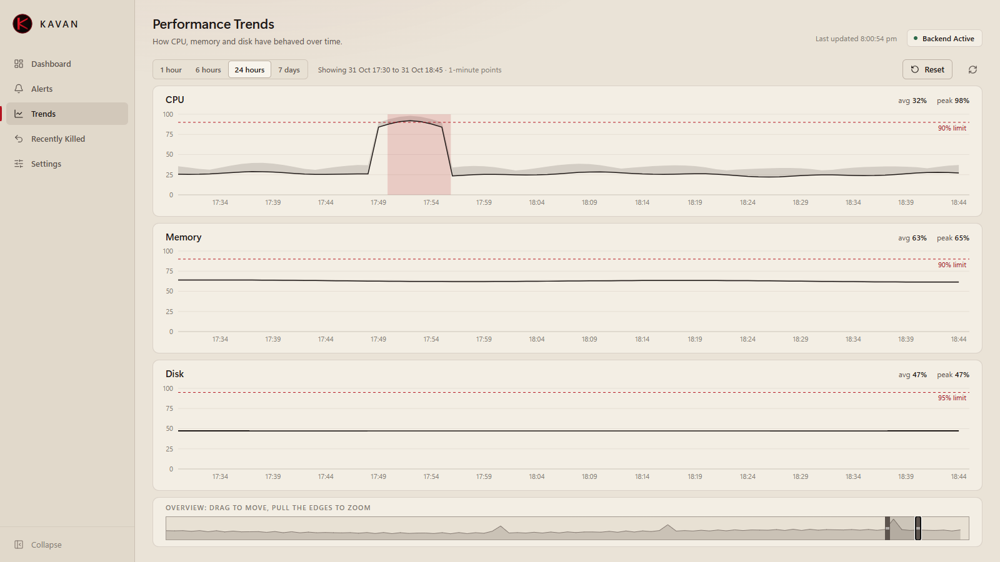
  </picture>
</p>

### Recently killed

End the wrong program by mistake? Restore it in one click.

<p align="center">
  <picture>
    <source media="(prefers-color-scheme: dark)" srcset="web/shots-src/killed-dark.png" />
    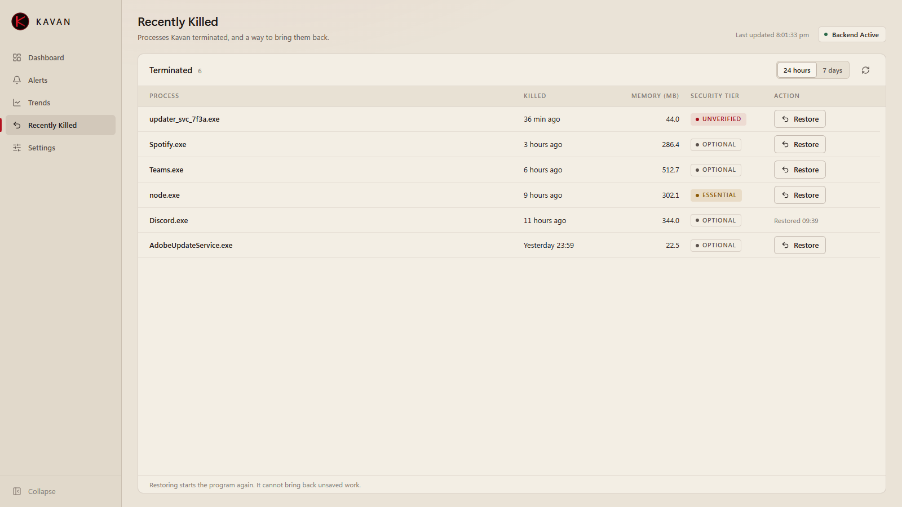
  </picture>
</p>

### Settings

Thresholds, protected apps, sounds, retention and startup.

<p align="center">
  <picture>
    <source media="(prefers-color-scheme: dark)" srcset="web/shots-src/settings-dark.png" />
    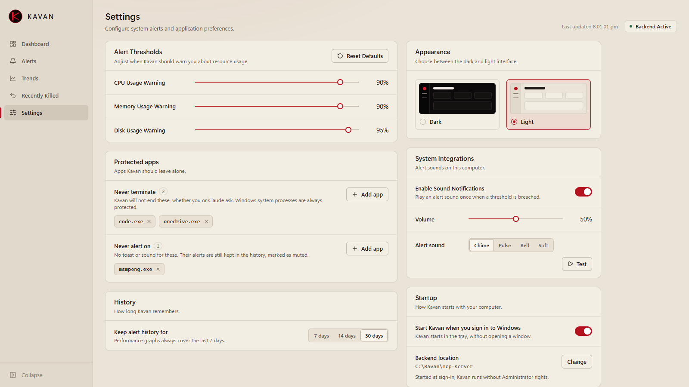
  </picture>
</p>

---

## Key features

| Feature | Detail |
|---|---|
| 🔴 **Tier 1 hard lock** | `explorer.exe`, `lsass.exe`, `svchost.exe` and the rest of a 20-name whitelist cannot be ended. The UI disables the Confirm button and the backend rejects the request at four independent layers |
| 🛡️ **PID reuse protection** | Staging stores the process `create_time`. If a different process recycles the same PID before execution, the kill is aborted |
| 🎯 **Single-use approvals** | An approval is consumed the moment it is used, so double-clicks and replays cannot kill twice. It expires after 5 minutes |
| ⚡ **Non-blocking backend** | Long psutil scans run in worker threads (`asyncio.to_thread`), so the event loop never freezes on a heavy process list |
| 📊 **Real-time dashboard** | CPU, memory and disk gauges updated every 2 seconds, colour-coded against your limits |
| 📋 **Virtualised process table** | `@tanstack/react-virtual` renders 800+ processes smoothly, with only the visible rows in the DOM |
| 🔊 **Alert sounds** | Four built-in sounds (chime, pulse, bell, soft), a volume slider and a Test button. A breach sounds once when it starts, not on every repeat |
| 🛡️ **Protected apps** | A never-terminate list is enforced in the backend, at the kill gates and in front of the OS call, so neither the app nor Claude can end a listed process. A never-alert list keeps a program's alerts in the history, marked muted, without a toast or sound |
| ↩️ **Undo and Restore** | A killed program is relaunched from its stored executable path with its original arguments, at most once. The toast after a kill offers Undo, and the Recently Killed page lists the last 24 hours or 7 days |
| 🗃️ **Continuous history** | One row of CPU, memory and disk per minute and one row per alert episode, whether or not the window is open. Metrics are kept 7 days, alerts 7, 14 or 30 days |
| 📜 **Alert history** | Every alert with its start and end, peak, the readings at that moment, and the top process at the time. Filter by date, type and severity. Updates live without polling |
| 📈 **Performance trends** | Charts from 1 hour to 7 days with peak band, limit line and alert regions. Drag to pan and zoom, and zooming loads finer detail. A period with no data is drawn as a gap, never joined across |
| 🕵️ **Suspicious-process watch** | A scan once a minute raises an alert for any process with no window using over 25% CPU, even when the dashboard is closed |
| 🚀 **Start with Windows** | The app can start its own backend at sign-in, in the tray, and a second launch brings the first window forward |
| 🔔 **Native notifications** | Windows Action Center alerts fire on CPU and memory spikes even when the window is hidden |
| 🗂️ **System tray** | Left-click restores the window, right-click opens the menu, and the icon colour reflects the alert state |
| 🤝 **Dual-interface concurrency** | WAL mode lets the desktop backend and Claude's process read and write simultaneously without lock errors |

---

## Architecture

### System overview

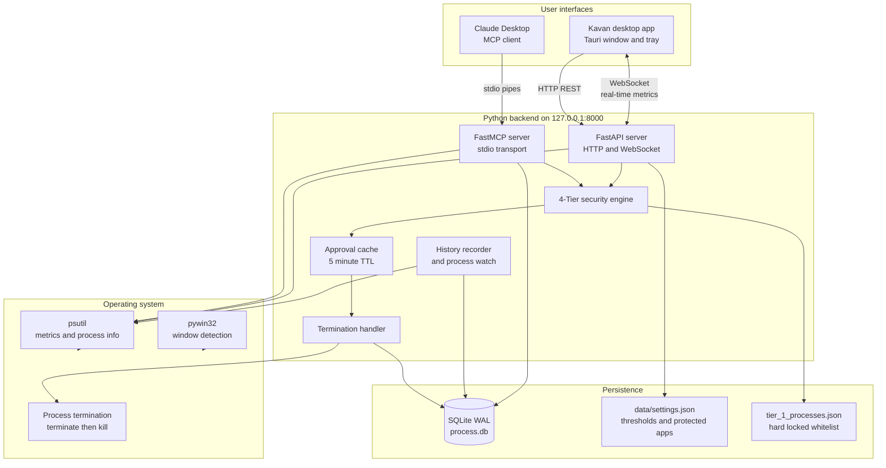

### Runtime topology: who runs where

Claude Desktop starts its own copy of `main.py` for the MCP transport, and the Kavan app starts a second one in dashboard-only mode. **Only one process can own port 8000**, and that process is the one that serves the dashboard and records history. The other still provides the MCP tools, so nothing is recorded twice.

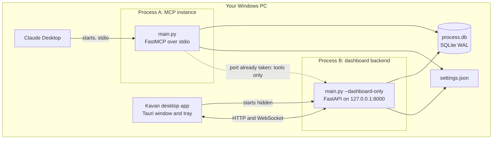

### Backend layers

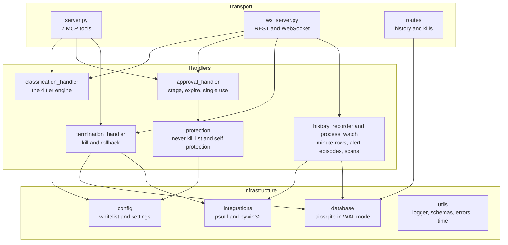

### Dual-interface data flow

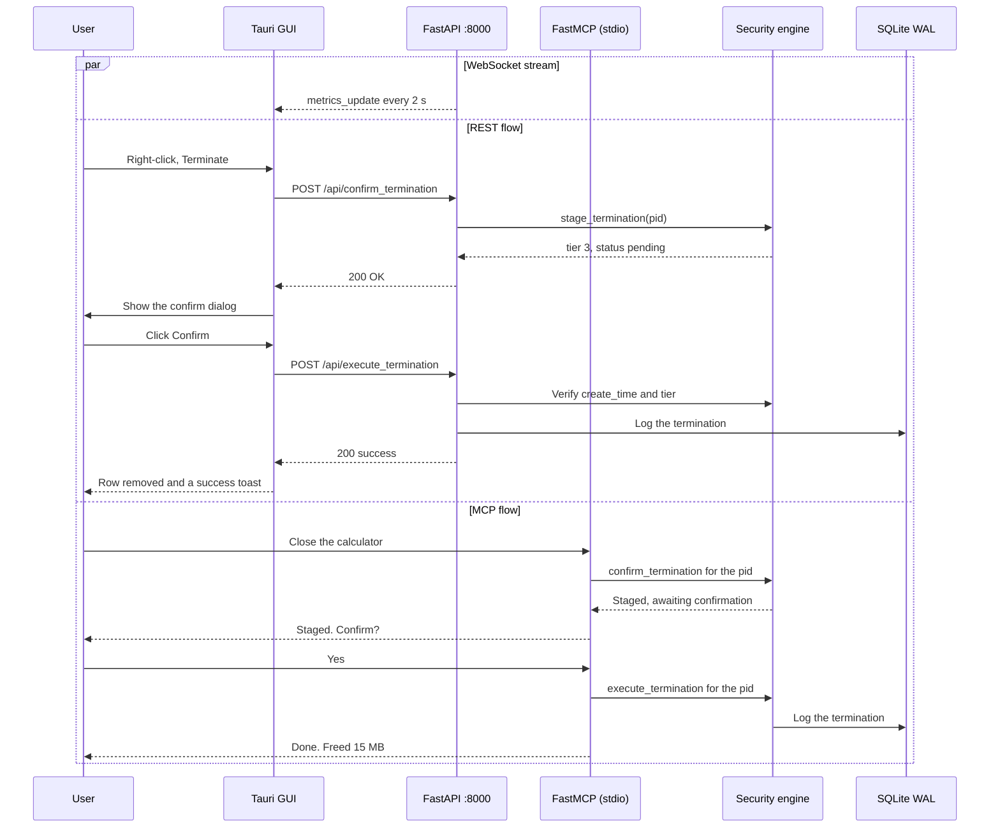

### Monitoring and history pipeline

The backend keeps recording whether or not the window is open.

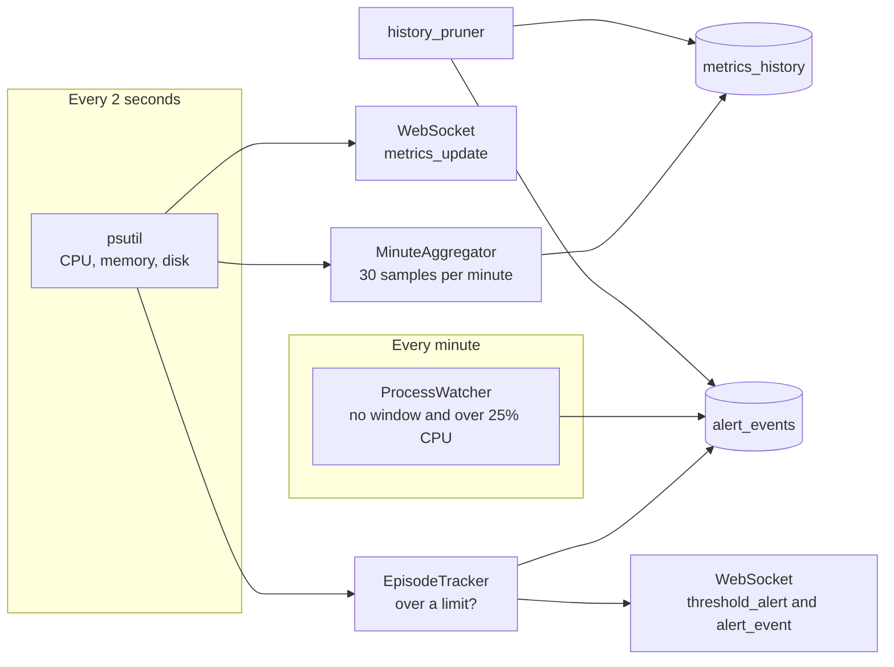

### Alert episode lifecycle

An alert is one **episode**, not one message per breach. Alerts repeat every 3 seconds while a value stays over its limit, so storing each would flood the history.

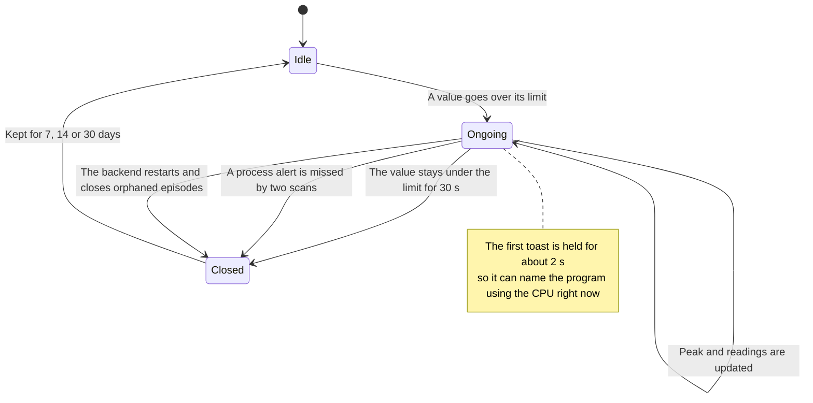

### WebSocket connection states in the app

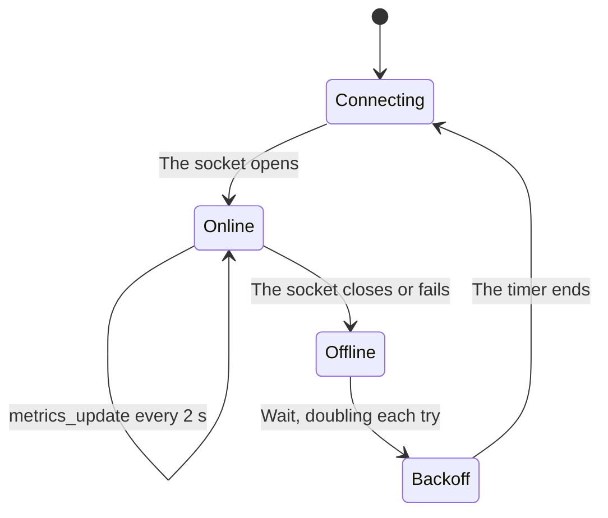

### Desktop app structure

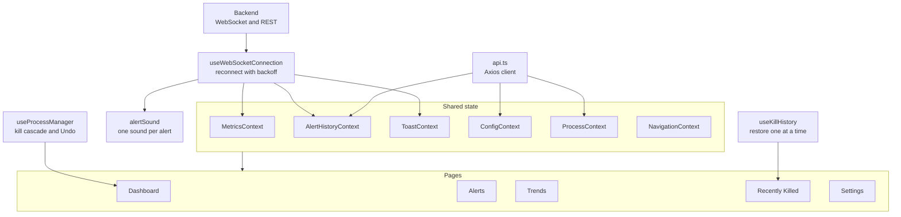

### Tauri shell startup

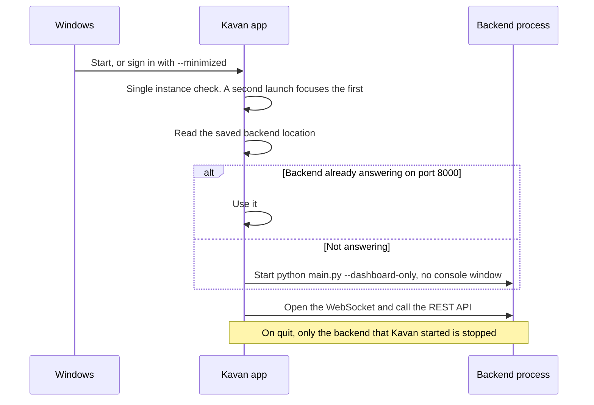

### Settings persistence

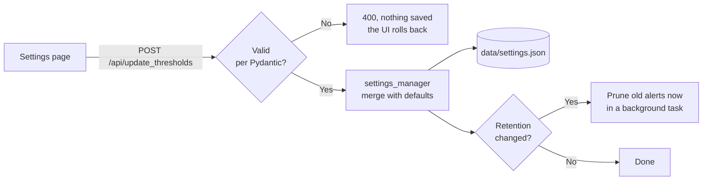

### Database schema

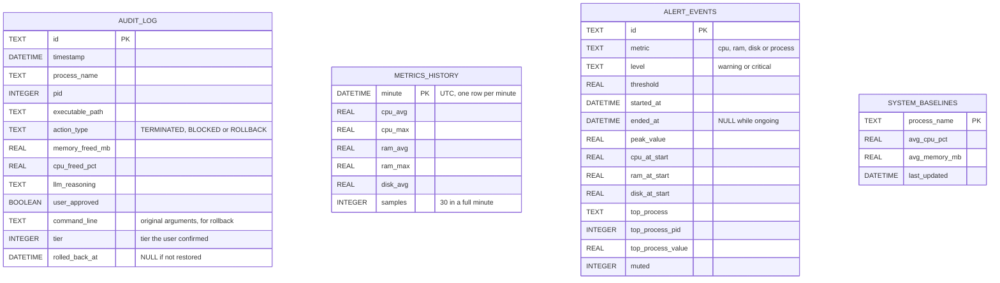

`metrics_history` is kept for 7 days and closed alerts for 7, 14 or 30 days, as chosen in Settings. `system_baselines` is created but not written to yet (it is reserved for the V2.2 plan).

---

## Security model

Kavan gives an AI, and a UI, the ability to end processes. The security model exists so that this is only ever possible for the right processes, with a person's consent.

### The four tiers

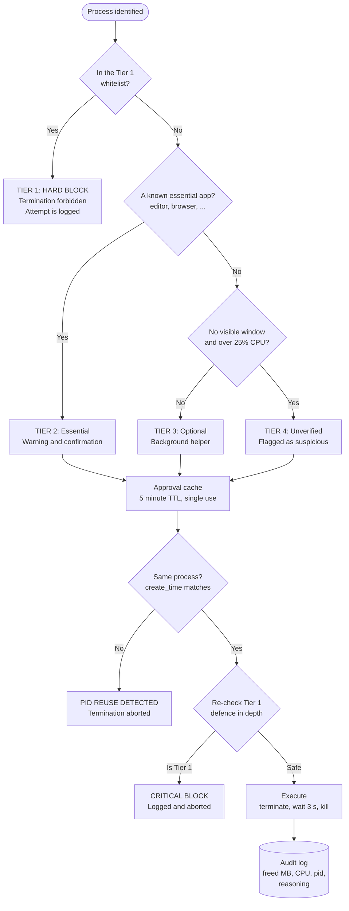

| Tier | Name | Examples | What happens |
|---|---|---|---|
| **1** | System | `explorer.exe`, `lsass.exe`, `svchost.exe`, `csrss.exe`, `wininit.exe`, `services.exe`, `smss.exe`, `System`, `taskmgr.exe` | Can never be ended, by you or by Claude |
| **2** | Essential | Editors, browsers, chat and media apps | A clear warning, then your confirmation |
| **3** | Optional | Background helpers, updaters, other apps | Safe to end if you need the resources |
| **4** | Unverified | An unknown program with no window using over 25% CPU | Flagged as suspicious |

### Defence in depth

Tier 1 is enforced at **four independent layers**, so a bug in one does not open a hole:

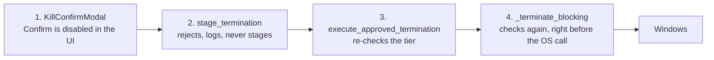

### The local-only request guard

CORS alone is not enough: it only stops a browser from *reading* a response, the request still runs, and it does not apply to WebSockets. Kavan adds a guard that rejects foreign requests before they reach any route.

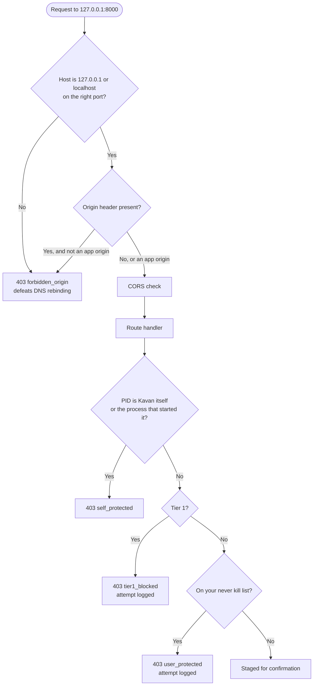

### The two-step kill

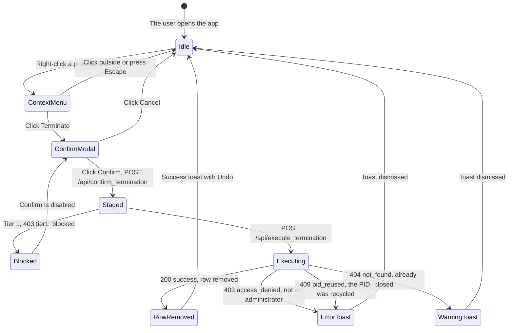

### Approval lifecycle

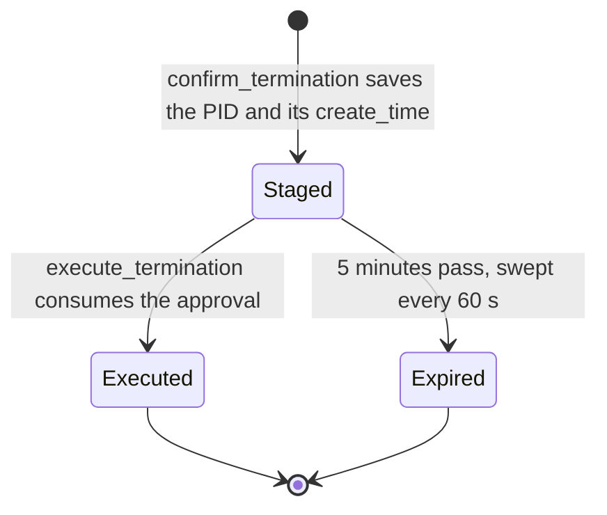

### Undo: how a kill is restored

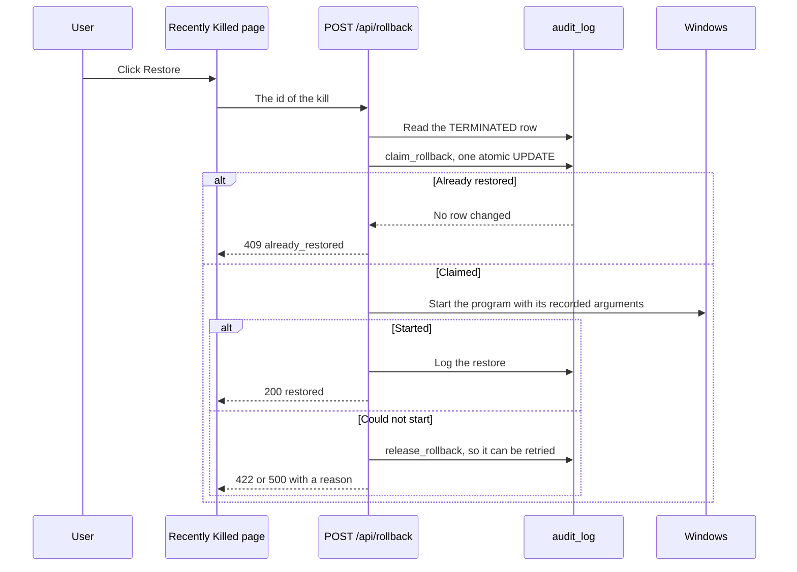

### Threat model

| Threat | Mitigation |
|---|---|
| A web page you have open calls the local API | The Host and Origin guard answers `403 forbidden_origin`. WebSockets are closed with code 1008 |
| DNS rebinding | The Host header must be `127.0.0.1` or `localhost` on the right port |
| An AI or a script ends a critical Windows process | Tier 1 is enforced at four independent layers |
| An AI ends something without your consent | Every kill is staged, then confirmed. Approvals expire after 5 minutes and work once |
| A PID is recycled between staging and execution | The `create_time` check returns `409 pid_reused` |
| Kavan ends itself or the process that started it | `protected_pids()` returns `403 self_protected` |
| You want a program left alone | The never-terminate list is refused at the gates and in front of the OS call |
| Double-clicks or replayed requests | Approvals are consumed on use. Restores are claimed atomically |
| A hand-edited settings file with bad values | Invalid entries fall back to their defaults before reaching the alert loop |
| Data leaving your PC | The app makes no external requests. See [Data and privacy](#data-and-privacy) |

### What Kavan does not do

- It is **not a sandbox or an antivirus**. Tiers 2 to 4 are heuristics, and you are always the one who confirms.
- Run with **Administrator rights**, Kavan can end more programs. A backend started at sign-in runs without them, so ending a privileged process returns "Permission Denied".
- **Restore starts the program again. It cannot bring back unsaved work.** A restored program runs with the rights of the backend.

---

## Tech stack

<div align="center">

### Backend
[](https://python.org)
[](https://fastapi.tiangolo.com)
[](https://gofastmcp.com)
[](https://sqlite.org)
[](https://docs.pydantic.dev)
[](https://www.uvicorn.org)
[](https://github.com/giampaolo/psutil)
[](https://github.com/mhammond/pywin32)
[](https://github.com/omnilib/aiosqlite)
[](https://websockets.readthedocs.io)
[](https://www.python-httpx.org)

### Desktop app
[](https://tauri.app)
[](https://rust-lang.org)
[](https://react.dev)
[](https://typescriptlang.org)
[](https://vite.dev)
[](https://tailwindcss.com)
[](https://recharts.org)
[](https://axios-http.com)
[](https://lucide.dev)
[](https://tanstack.com/virtual)

### Website
[](https://nextjs.org)
[](https://tailwindcss.com)
[](https://vercel.com)
[](https://lenis.darkroom.engineering)
[](https://sharp.pixelplumbing.com)

### Testing, quality and delivery
[](https://pytest.org)
[](https://vitest.dev)
[](https://docs.astral.sh/ruff)
[](https://eslint.org)
[](https://mermaid.js.org)

</div>

### Full list of components

| Layer | Component | Role |
|---|---|---|
| **Backend** | Python 3.11+ | Runtime |
| | FastMCP | Exposes the 7 tools over the Model Context Protocol (stdio) |
| | FastAPI and uvicorn | REST API and WebSocket server on `127.0.0.1:8000` |
| | websockets | WebSocket transport used by uvicorn |
| | Pydantic v2 | Strict request validation |
| | psutil | Metrics and process enumeration |
| | pywin32 | Window detection and deep process inspection |
| | aiosqlite and SQLite (WAL) | The shared database, safe for two processes |
| | httpx | HTTP client used by the test suite |
| **Desktop** | Tauri 2 and Rust | Window, tray, backend start and stop, autostart, single instance |
| | Tauri plugins | `notification`, `opener`, `dialog`, `autostart`, `single-instance` |
| | serde and serde_json | Reading and writing the saved backend location |
| | Microsoft Edge WebView2 | Renders the UI inside the Tauri window on Windows |
| | React 19 and TypeScript | The UI |
| | Vite 8, PostCSS and Autoprefixer | Build and CSS pipeline |
| | Tailwind CSS 4 | Styling with shared design tokens for the dark and light themes |
| | Recharts 3 | Trend charts |
| | TanStack Virtual | Virtualised process and alert tables |
| | Axios | Typed REST client |
| | Lucide React | Icons |
| | Web Audio API | The four alert sounds, with no audio files |
| **Website** | Next.js 16 (static export) | The one-page site in `web/` |
| | Tailwind CSS 4, `next/font` | Styling and self-hosted fonts (Playfair Display, Inter, JetBrains Mono) |
| | Lenis | Smooth scrolling |
| | sharp | Turns screenshots into AVIF and WebP |
| | Vercel, Vercel Analytics, Speed Insights | Hosting, visit counts and page-speed figures for the website only |
| **Testing and quality** | pytest and pytest-asyncio | 641 backend tests |
| | Vitest | 81 desktop tests |
| | Ruff | Python lint |
| | ESLint and `tsc` | Lint and type checks for the desktop app and the website |
| **Delivery** | Tauri bundler, NSIS and WiX | The Windows setup `.exe` and `.msi` |
| | GitHub Releases | Where the installer is published |
| **Docs** | Mermaid | The diagrams in this README |

---

## Design decisions

| Decision | Why | Trade-off |
|---|---|---|
| **Two interfaces, one backend** | A chat window cannot show a live gauge, and a dashboard cannot reason about a vague problem. Sharing the backend means both obey the same rules | The backend must be safe for two clients at once |
| **SQLite in WAL mode** | Claude's process and the desktop backend write the same file at the same time without lock errors, and there is nothing to install or run | Fine for one machine, not for a shared server |
| **WebSocket push, not polling** | Constant polling from the UI costs CPU. A push every 2 seconds is cheaper and always fresh | The app needs reconnect logic, which it has |
| **Tauri, not Electron** | A small installer (about 2.3 MB), and a native tray and notifications | A Rust toolchain is needed to build it |
| **Stage, then execute** | Every kill needs a person to confirm, and a confirmation works once and expires. This is what makes it acceptable to let an AI propose kills | One extra step for the user |
| **Four layers for Tier 1** | A critical process must survive a bug in any single layer | Some duplicated checks, on purpose |
| **A Host and Origin guard on localhost** | A web page in your browser can otherwise reach `127.0.0.1:8000` and the kill endpoints | Non-browser local clients that send no Origin are allowed |
| **Alert episodes, not alert rows** | One breach is one row with a start, an end and a peak, instead of a row every 3 seconds | Slightly more tracking code |
| **Gaps drawn as gaps** | A period with no data (the PC was off) must not look like a flat line | The charts do a little extra work |
| **Client-side sorting and filtering** | Keeps the Python side focused on system calls | The UI holds the whole process list |
| **Virtualised tables** | 800+ processes would otherwise slow the DOM | A little more code in the table |
| **Local-first, no telemetry in the app** | A tool that sees your processes should not send them anywhere | No cloud features, by design |

---

## Project structure

```text
KavanMCP/
├── mcp-server/                      # Python backend
│   ├── main.py                      # Entry point: MCP server, FastAPI, TTL sweeper. --dashboard-only for the app
│   ├── server.py                    # The 7 MCP tool definitions (FastMCP)
│   ├── ws_server.py                 # FastAPI app: REST, WebSocket, request guard, history loops
│   ├── routes/
│   │   ├── history.py               # /api/alerts and /api/metrics/history
│   │   └── kills.py                 # /api/kills and /api/rollback
│   ├── handlers/
│   │   ├── approval_handler.py      # Pending approvals with a TTL
│   │   ├── classification_handler.py# The 4-tier classification
│   │   ├── termination_handler.py   # psutil kill, audit log, rollback
│   │   ├── protection.py            # Never-terminate list and self protection
│   │   ├── alert_handler.py         # Per-process anomaly flags
│   │   ├── history_recorder.py      # Minute aggregation and alert episode tracking
│   │   └── process_watch.py         # Timed scan: Tier 4 alerts, top-process lookup
│   ├── tools/                       # One file per MCP tool
│   ├── config/
│   │   ├── whitelist.py             # Tier 1 whitelist loader
│   │   └── settings_manager.py      # Settings file: validation, defaults, migration
│   ├── database/
│   │   ├── db.py                    # aiosqlite helpers and WAL setup
│   │   └── models.py                # SQL schema and migrations
│   ├── integrations/
│   │   ├── monitor.py               # psutil metrics
│   │   └── windows.py               # pywin32 window detection and deep inspection
│   ├── utils/                       # logger, Pydantic schemas, error wrapper, privileges, time formats
│   ├── resources/
│   │   └── tier_1_processes.json    # The hard-locked whitelist (20 names)
│   ├── scripts/                     # install_deps.bat, run_server.bat, check_admin.bat, test_runner.bat
│   ├── tests/                       # 641 tests, plus aids/ for manual runs
│   └── requirements.txt
│
├── desktop/                         # Tauri 2 and React 19 app
│   ├── src-tauri/
│   │   ├── src/lib.rs               # Commands, backend start and stop, autostart, single instance
│   │   ├── capabilities/default.json# Plugin permissions
│   │   ├── tauri.conf.json          # Window, tray, bundle and version
│   │   └── Cargo.toml
│   └── src/
│       ├── App.tsx                  # Providers and page lookup
│       ├── pages/                   # Dashboard, Alerts, Trends, RecentlyKilled, Settings
│       ├── components/              # dashboard, alerts, trends, rollback, settings, common, layout
│       ├── context/                 # Config, Metrics, Process, AlertHistory, Navigation, Toast
│       ├── hooks/                   # useWebSocketConnection, useProcessManager, useKillHistory, ...
│       ├── services/                # api.ts (Axios) and alertSound.ts (Web Audio)
│       ├── utils/                   # time.ts, series.ts, alertList.ts
│       └── styles/index.css         # Design tokens for both themes
│
├── web/                             # The Next.js website (static export)
│   ├── app/                         # layout, page, robots, sitemap, icons, global styles
│   ├── components/                  # sections/ (Nav, Hero, ...) and ui/ (Button, Card, ...)
│   ├── content/                     # release.json, site.ts, shots.ts
│   ├── scripts/                     # optimize-screenshots, make-icons, og.html
│   ├── shots-src/                   # Source screenshots (PNG)
│   └── public/                      # Optimised screenshots, logo, sharing image
│
├── docs/                            # PRD, TRD, API reference, release notes, website plan
├── phases/                          # V1 build plans
├── phases_v2/                       # V2 build plans (Phase0_v2.md to Phase10_v2.md)
├── phase_v2_1/                      # V2.1 plan and its 8 phase files
├── v2.2/                            # V2.2 plan (not built yet)
├── CLAUDE.md                        # Claude Code development guide
├── LICENSE                          # Apache License 2.0
└── README.md
```

---

## Getting started

### Prerequisites

| Requirement | Needed for | Notes |
|---|---|---|
| Windows 10 or 11, 64-bit | Everything | pywin32 and the tray require Windows |
| Python 3.11 or newer | The backend | `python --version` to check |
| Claude Desktop | The Claude features | Optional. The desktop app works fully without it |
| Administrator rights | Ending system-level programs | Optional. Kavan tells you when it is needed |
| Node.js 20 or newer | Building the app or the website | Only to build from source |
| Rust (stable) | Building the app | `rustup install stable`. Only to build from source |

### Option A: use the installer

1. Download `kavan_2.1.5_x64-setup.exe` from the [latest release](https://github.com/Rahul-8283/KavanMCP/releases/latest) and run it. Check the file against the SHA-256 shown on the release page and on the [website](https://kavanmcp.vercel.app).
2. The installer is not code-signed yet, so Windows may warn about an unknown publisher. Choose **More info**, then **Run anyway**, if you trust the source.
3. The installer does not include Python. Get the `mcp-server` folder from this repository and set up its environment once:

   ```powershell
   cd mcp-server
   python -m venv venv
   .\venv\Scripts\Activate.ps1
   pip install -r requirements.txt
   ```
4. Open Kavan, go to **Settings**, and under **Startup** choose that folder as the **Backend location**. Kavan then starts its own backend, and can start with Windows.

### Option B: run from source

**1. Clone and install the backend**

```powershell
git clone https://github.com/Rahul-8283/KavanMCP.git
cd KavanMCP/mcp-server

python -m venv venv
.\venv\Scripts\Activate.ps1
pip install -r requirements.txt
```

**2. Run the backend (elevated)**

Run it as Administrator so it can inspect privileged processes.

```powershell
# In an elevated PowerShell
python main.py
```

Or use the script:

```powershell
Start-Process -FilePath ".\scripts\run_server.bat" -Verb RunAs
```

`main.py` starts the MCP server on stdio and the FastAPI server on `http://127.0.0.1:8000`. To run only the dashboard backend, without the MCP transport (this is what the desktop app starts), use `python main.py --dashboard-only`.

**3. Run the desktop app in development**

```powershell
cd ../desktop
npm install
npm run tauri dev
```

**4. Connect Claude Desktop (optional)**

Add this to `%APPDATA%\Claude\claude_desktop_config.json`, with the paths changed to where `mcp-server` is on your PC:

```json
{
  "mcpServers": {
    "KavanMCP": {
      "command": "C:\\path\\to\\KavanMCP\\mcp-server\\venv\\Scripts\\python.exe",
      "args": [
        "C:\\path\\to\\KavanMCP\\mcp-server\\main.py"
      ]
    }
  }
}
```

Restart Claude Desktop. The Kavan tools appear automatically.

**5. Build the Windows installer**

```powershell
cd desktop
npm run tauri build
```

The first release build takes about ten minutes. The installers are written to `desktop\src-tauri\target\release\bundle\`:

- `nsis\kavan_2.1.5_x64-setup.exe`: the setup program
- `msi\kavan_2.1.5_x64_en-US.msi`: a Windows Installer package

---

## Configuration

Settings live in a JSON file that you can edit by hand, but the app is the normal way to change them. Invalid values fall back to their defaults instead of reaching the alert loop.

| Key | Default | Valid values | Meaning |
|---|---|---|---|
| `cpu_threshold` | `90` | Percent | CPU alert limit |
| `ram_threshold` | `90` | Percent | Memory alert limit |
| `disk_threshold` | `95` | Percent | Disk alert limit |
| `theme` | `"dark"` | `dark`, `light` | The app theme |
| `sound_alerts` | `true` | `true`, `false` | Play a sound when a limit is breached |
| `sound_volume` | `50` | 0 to 100 | Alert volume |
| `sound_choice` | `"chime"` | `chime`, `pulse`, `bell`, `soft` | Which sound plays |
| `alert_retention_days` | `30` | `7`, `14`, `30` | How long closed alerts are kept. A shorter choice applies at once |
| `never_kill` | `[]` | Program names | Programs neither the app nor Claude may end |
| `never_alert` | `[]` | Program names | Programs whose alerts are recorded quietly, marked muted |

### Where data lives

| Item | Default location | Override |
|---|---|---|
| Database (`process.db`) | `mcp-server/data/` | `KAVAN_DATA_DIR` |
| Settings (`settings.json`) | `mcp-server/data/` | `KAVAN_SETTINGS_PATH`, or move with `KAVAN_DATA_DIR` |
| Logs | `mcp-server/logs/` | |
| The saved backend location | The app's config folder | Settings, then Startup |

`settings.json` is not tracked by git. Settings from before 2.1 are copied across on first start.

---

## MCP tool reference

### `analyze_system`
Returns global CPU and memory totals and the top resource users, classified by tier.

```jsonc
// Request
{}

// Response
{
  "total_cpu_percent": 15.2,
  "total_memory_gb": 15.8,
  "used_memory_gb": 7.1,
  "top_cpu_hogs": [
    { "pid": 1204, "name": "chrome.exe", "cpu_percent": 5.1, "memory_mb": 450.2,
      "tier": 2, "is_headless": false, "anomaly_flags": [] }
  ],
  "top_memory_hogs": [ /* same shape */ ]
}
```

### `list_processes`
Lists running processes with an optional name filter. Tier 1 processes are left out unless `include_tier_1` is true or a name is searched for.

```jsonc
// Both fields are optional
{ "filter_name": "chrome", "include_tier_1": false }
```

### `explain_process`
Deep inspection of one process before proposing to end it: command line, executable path, parent and children, third-party modules and safety notes.

```jsonc
{ "pid": 1204 }
```

### `confirm_termination`
**The stage gate.** Adds PIDs to the approval cache. Claude must show this list to you before calling `execute_termination`.

```jsonc
{ "pids": [9999, 8888] }
```

### `execute_termination`
**The kill gate.** Only runs PIDs staged by `confirm_termination` within the last 5 minutes.

```jsonc
{ "pids": [9999], "reasoning": "User confirmed; freeing memory." }
```

### `view_audit_log`
Returns the recent termination history from the database.

```jsonc
{ "hours_back": 24 }
```

### `rollback_last_action`
Relaunches the most recent kill of that name or PID that has not been restored yet, from its stored executable path and with its original arguments. A kill already restored through the REST API is skipped.

```jsonc
{ "process_identifier": "notepad.exe" }
```

---

## REST and WebSocket API reference

All endpoints are on `http://127.0.0.1:8000`. CORS is restricted to the Tauri window origins, and a request from any other web origin is refused before it reaches a route.

| Method | Path | Description |
|---|---|---|
| `GET` | `/api/list_processes` | All running processes with their tier |
| `GET` | `/api/get_config` | Current thresholds and preferences |
| `POST` | `/api/update_thresholds` | Partially update settings: thresholds, `theme`, `sound_alerts`, `sound_volume` (0 to 100), `sound_choice`, `alert_retention_days` (7, 14 or 30, applied at once), `never_kill`, `never_alert` |
| `POST` | `/api/confirm_termination` | Stage a PID. Tier 1 is rejected immediately |
| `POST` | `/api/execute_termination` | Run a staged kill, verifying `create_time`. The response carries `audit_id` |
| `GET` | `/api/alerts` | Alert history. Filters: `from`, `to`, `metric`, `level`, `limit` |
| `GET` | `/api/metrics/history` | CPU, memory and disk over time. `range` (`1h`, `6h`, `24h`, `7d`) or `from` and `to` |
| `GET` | `/api/kills` | Processes killed in the last `hours` (1 to 168, default 24), newest first, each with `tier`, `can_restore` and `restore_blocked_reason`. Also `backend_elevated` |
| `POST` | `/api/rollback` | Restore one kill by `{ "id": "<audit_id>" }`, at most once |
| `WS` | `/ws` | `metrics_update` every 2 s, `threshold_alert` when a limit is exceeded, `alert_event` when a stored alert starts, changes or ends |

### History bucketing

`/api/metrics/history` returns bucketed points, so a chart never gets more points than it can draw:

| Window | Bucket |
|---|---|
| Up to 2 hours | 60 seconds |
| Up to 12 hours | 5 minutes |
| Up to 48 hours | 15 minutes |
| Longer | 2 hours |

### Error codes returned in `detail.code`

| Code | HTTP | Meaning |
|---|---|---|
| `tier1_blocked` | 403 | A Tier 1 system process, always rejected |
| `self_protected` | 403 | The PID is Kavan itself or the process that started it |
| `user_protected` | 403 | On your never-terminate list. Remove it in Settings to allow the kill |
| `forbidden_origin` | 403 | The request came from a web origin other than the app |
| `access_denied` | 403 | Needs Administrator rights |
| `not_approved` | 409 | The PID was not staged, or the approval expired |
| `pid_reused` | 409 | A different process now holds this PID |
| `not_found` | 404 | The process already exited, or no kill has that id |
| `already_restored` | 409 | That kill was restored already |
| `no_path`, `exe_missing` | 422 | The kill has no recorded executable, or it is no longer on disk |
| `launch_failed` | 500 | Windows refused to start the program. The kill stays restorable, so it can be retried |
| `invalid_range`, `range_too_short`, `range_too_long` | 400 | A history window that is reversed, under 10 minutes or over 7 days |
| `error` | 500 | An unexpected failure |

---

## Data and privacy

Kavan is built so that the data about your machine stays on your machine.

| | |
|---|---|
| **The app and the backend** | Make no external requests. There is no cloud, no account, no API key and no telemetry |
| **The API** | Listens on `127.0.0.1` only, and refuses requests from web pages |
| **What is stored** | CPU, memory and disk history (7 days), alert episodes (7, 14 or 30 days), and a permanent audit log of every kill, block and restore |
| **Where** | A SQLite file and a settings file in the data folder |
| **Claude** | Reads what the MCP tools return. It sees process names and figures when you ask it to look, and nothing else |
| **The website** | A separate project in `web/`. It uses Vercel Analytics and Speed Insights for anonymous visit and page-speed figures, and stores only your theme in the browser |

To remove everything Kavan has stored, uninstall it and delete the `mcp-server/data` folder.

---

## Testing

```mermaid
flowchart TD
    subgraph Backend["Backend: 641 tests (pytest)"]
        B1["Unit<br/>approval, classification, database, monitor"]
        B2["API<br/>termination, kills, alerts, metrics"]
        B3["Security<br/>every route attacked: origins, hosts, hostile input"]
        B4["Resilience<br/>sleep, failing database, time zones, damaged settings"]
        B5["Upgrade<br/>a V2.0.1 database and settings carry over"]
    end
    subgraph Desktop["Desktop: 81 tests (Vitest)"]
        D1["Pure logic<br/>series, time, alert list, rows, wording, presets"]
        D2["Alert sound<br/>volume curve and once per alert"]
    end
    subgraph Manual["By hand: tests/aids"]
        M1["CPU burn and memory hold"]
        M2["Seed history and age rows"]
        M3["Live alert check<br/>real CPU, real backend"]
        M4["24 hour soak schedule"]
    end
    Backend --> Gate{"All green?"}
    Desktop --> Gate
    Gate -->|Yes| Merge["Safe to merge"]
    Manual -.-> Merge
```

### Run the tests

```powershell
# Backend (from mcp-server, with the virtual environment)
venv\Scripts\python.exe -m pytest -q
# 641 passed

# Backend lint
venv\Scripts\python.exe -m ruff check .

# Desktop (from desktop)
npm test
# 81 passed

# Website (from web)
npm run typecheck
npm run lint
npm run build
```

The manual aids in `mcp-server/tests/aids/` create real CPU load or seed a scratch database. They write only to a folder you point `KAVAN_DATA_DIR` at, and refuse to run without it, so they can never touch your real data.

---

## The website

The site in [`web/`](web) is a one-page Next.js pitch site, exported as static files and hosted on Vercel at [kavanmcp.vercel.app](https://kavanmcp.vercel.app).

```mermaid
flowchart LR
    SRC["shots-src<br/>PNG captures"] -->|"npm run shots<br/>sharp"| IMG["public/shots<br/>AVIF and WebP"]
    REL["content/release.json"] --> NEXT
    IMG --> NEXT["next build<br/>static export"]
    NEXT --> OUT["out/"]
    OUT --> V["Vercel"]
    V --> SITE["kavanmcp.vercel.app"]
```

Its download card has three states, chosen by `state` in `web/content/release.json`:

```mermaid
stateDiagram-v2
    [*] --> Soon
    Soon --> Preview: The repository is public
    Preview --> Ready: The installer is published and its details are filled in
    Ready --> Preview: Installer details are missing, so it falls back
    note right of Soon
        Soon: coming soon, no link that can fail
        Preview: source build steps
        Ready: download button, size and SHA-256
    end note
```

```powershell
cd web
npm install
npm run dev      # http://localhost:3000
npm run build    # writes the site to out/
```

Set `NEXT_PUBLIC_SITE_URL` when building for deployment, so the canonical link, sitemap and sharing tags use the right address. See [`web/README.md`](web/README.md) for details.

---

## Releasing

```mermaid
flowchart TD
    A["Bump the version<br/>app, Tauri config, Cargo, MCP server, website"] --> B["npm run tauri build"]
    B --> C["Setup exe and MSI"]
    C --> D["Test install and uninstall<br/>on a clean PC"]
    D --> E["SHA-256 of the exe"]
    E --> F["Tag v2.1.5<br/>GitHub Release with the exe attached"]
    E --> G["Update web/content/release.json"]
    G --> H["Redeploy the website"]
    F --> H
```

The version is set in `desktop/package.json` (and its lock file), `desktop/src-tauri/tauri.conf.json`, `desktop/src-tauri/Cargo.toml` (and `Cargo.lock`), and `mcp-server/server.py`, and is shown on the website through `web/content/release.json`.

---

## Roadmap

### Where the project has been

```mermaid
gantt
    title KavanMCP: completed phases
    dateFormat YYYY-MM-DD
    section V2 foundation
    Phase 0 · Tauri setup              :done, 2026-09-10, 1d
    Phase 1 · App shell and context    :done, 2026-09-11, 2d
    section V2 real-time data
    Phase 2 · WebSocket and gauges     :done, 2026-09-13, 2d
    Phase 3 · Process table            :done, 2026-09-15, 2d
    Phase 4 · Sort and filter          :done, 2026-09-17, 1d
    section V2 UX and config
    Phase 5 · Settings and thresholds  :done, 2026-09-18, 2d
    Phase 6 · Toast alerts             :done, 2026-09-20, 2d
    section V2 OS integration
    Phase 7 · Tray integration         :done, 2026-09-22, 3d
    Phase 8 · Kill flow                :done, 2026-09-25, 5d
    section V2 QA
    Phase 9 · Feature testing          :done, 2026-10-01, 2d
    Phase 10 · E2E and Claude sync     :done, 2026-10-04, 1d
    section V2.1 history
    Phase 1 · Metrics and alert storage :done, 2026-10-05, 1d
    Phase 2 · Alert history page       :done, 2026-10-06, 1d
    Phase 3 · Performance graphs       :done, 2026-10-06, 1d
    Phase 4 · Rollback backend         :done, 2026-10-13, 1d
    Phase 5 · Rollback UI              :done, 2026-10-24, 1d
    Phase 6 · Protected apps and startup :done, 2026-10-30, 1d
    Phase 7 · Sound and retention      :done, 2026-10-30, 1d
    Phase 8 · Complete testing         :done, 2026-10-31, 1d
    section 2.1.5
    Cleanup, website and release       :done, 2026-10-31, 1d
```

### What is planned

V2.2 is a plan only. None of it is available yet. See [`v2.2/PLAN_V2_2.md`](v2.2/PLAN_V2_2.md).

```mermaid
flowchart LR
    NOW["2.1.5<br/>Watch, explain, act, undo"] --> V22
    subgraph V22["V2.2: planned, not built"]
        direction TB
        A["Process baselines<br/>and anomaly detection"]
        B["Smart suggestions<br/>baseline-aware analysis"]
        C["Auto-kill policies<br/>rules you write"]
        D["Behaviour learning"]
        E["Scheduled optimization"]
    end
    classDef planned stroke-dasharray: 5 5
    class A,B,C,D,E planned
```

Tier 1 immunity, confirm-then-execute for Claude, and your never-kill and never-alert lists are not changed by anything on this roadmap.

---

## Troubleshooting

| Symptom | Likely cause | What to do |
|---|---|---|
| The app shows **Offline** | The backend is not running | Set the **Backend location** in Settings, or start `python main.py` yourself |
| `403 access_denied` when ending a program | The backend does not have Administrator rights | Start the backend elevated. A backend started at sign-in runs without them |
| `409 not_approved` | The approval expired (5 minutes) or was already used | Stage the kill again |
| `409 pid_reused` | A different process took that PID | Refresh the list and stage the kill again |
| `403 user_protected` | The program is on your never-terminate list | Remove it in **Settings**, then **Protected apps** |
| Restore says **File missing** | The program's executable is no longer on disk | Reinstall the program |
| Windows warns about an unknown publisher | The installer is not code-signed yet | Choose **More info**, then **Run anyway** |
| `No Python found at ...` when setting the backend location | The folder has no `venv` | Create the virtual environment in `mcp-server` first |
| Port 8000 is already in use | Another Kavan instance owns it | This is normal when Claude Desktop and the app both run. One instance serves the dashboard, and the other provides tools only |
| `No module named pytest` | The system Python was used | Run `venv\Scripts\python.exe -m pytest -q` from `mcp-server` |

---

## Documentation index

| Document | What it covers |
|---|---|
| [`docs/PRD_v2.md`](docs/PRD_v2.md) | Product requirements for V2: the problem, principles and feature specifications |
| [`docs/TRD_v2.md`](docs/TRD_v2.md) | Technical requirements for V2 |
| [`docs/PRD_v1.md`](docs/PRD_v1.md), [`docs/TRD_v1.md`](docs/TRD_v1.md), [`docs/API_v1.md`](docs/API_v1.md) | The V1 backend |
| [`docs/RELEASE_NOTES_V2_1_5.md`](docs/RELEASE_NOTES_V2_1_5.md) | What changed in 2.1.5 |
| [`docs/RELEASE_NOTES_V2_1.md`](docs/RELEASE_NOTES_V2_1.md) | What changed in 2.1.0, including upgrade notes |
| [`docs/WEBSITE_PLAN.md`](docs/WEBSITE_PLAN.md) | The plan behind the website |
| [`phase_v2_1/PLAN_V2_1.md`](phase_v2_1/PLAN_V2_1.md) | The V2.1 plan and its phase files |
| [`v2.2/PLAN_V2_2.md`](v2.2/PLAN_V2_2.md) | The V2.2 plan (not built) |
| [`CLAUDE.md`](CLAUDE.md) | The development guide for Claude Code |
| [`web/README.md`](web/README.md) | How to edit, build and deploy the website |

---

## Contributing

Contributions and bug reports are welcome.

```mermaid
flowchart LR
    I["Open an issue<br/>or pick one"] --> BR["Create a branch<br/>from main"]
    BR --> CH["Make the change<br/>small commits"]
    CH --> CK["Run the checks<br/>pytest, ruff, npm test"]
    CK --> PR["Open a pull request"]
    PR --> RV["Review"]
    RV --> MG["Merge to main"]
    MG --> TG["Tag a release"]
```

- Use short, conventional commit messages, as the history does: `feat`, `fix`, `docs`, `test`, `refactor`, `style` and `chore`, with an optional scope such as `feat(web):`.
- Run `pytest` and `ruff check .` in `mcp-server`, and `npm test` in `desktop`, before opening a pull request. Add a test for any behaviour you change.
- **Never weaken the Tier 1 protection.** Any change that touches the security engine needs a test showing a Tier 1 process still cannot be ended.
- Do not commit secrets, personal data, or your own `settings.json`.
- Please report security problems privately, for example through GitHub Security Advisories on this repository, rather than in a public issue.

---

## License

Licensed under the **Apache License 2.0**. See [`LICENSE`](LICENSE).

---

<div align="center">
  <br/>
  <p>Built by <a href="https://github.com/Rahul-8283"><strong>Rahul L S</strong></a> · <a href="https://www.linkedin.com/in/rahul-ls">LinkedIn</a></p>
  <p><sub>KavanMCP v2.1.5 · Apache License 2.0</sub></p>
</div>
